# ① Data tab

The Data tab is where you tell QMaxent **which species** you are modeling and
**which environmental variables** to use. Three controls deserve attention:
the presence-points selector, the environmental-raster list with its
**Check Raster Consistency** action, and the background-points sample size.

## Step by step

### Step 1. Choose the presence points

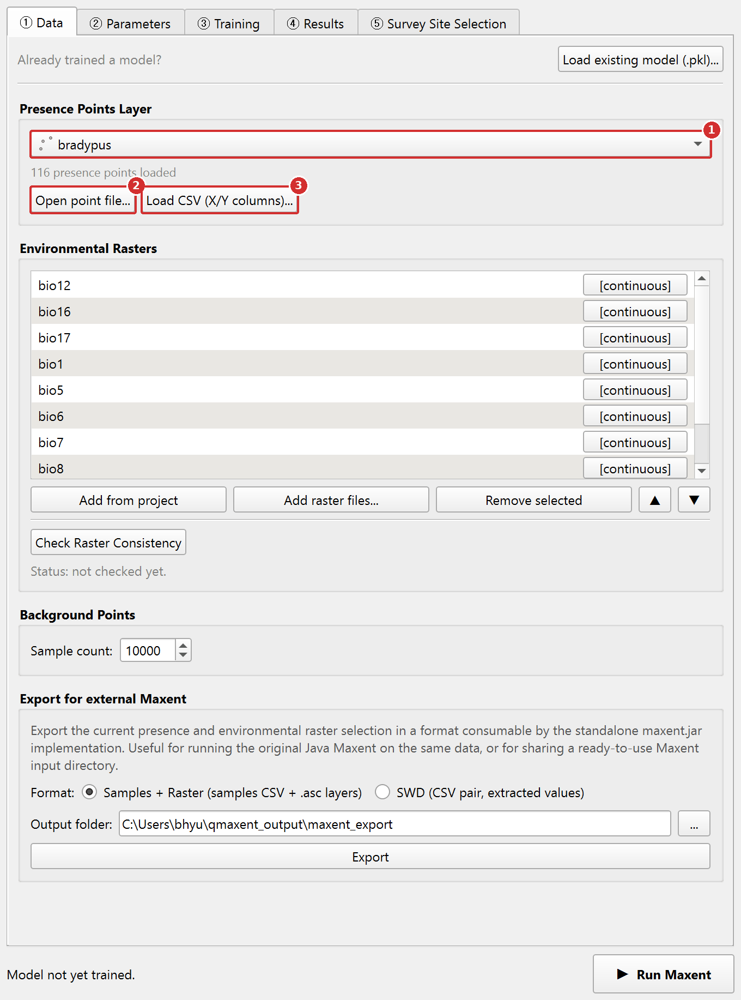{ .qm-shot width="680" }

1. **Presence Points Layer** lists every point layer in the project.
   Choose your species layer. The grey line below it tells you how many
   points were loaded.
2. **Open point file...** adds a point file (GeoPackage, shapefile,
   GeoJSON and other formats QGIS reads) to the project and selects it.
3. **Load CSV (X/Y columns)...** reads a table with coordinate columns
   (see Step 2).

### Step 2. (Optional) Load presence points from a CSV table

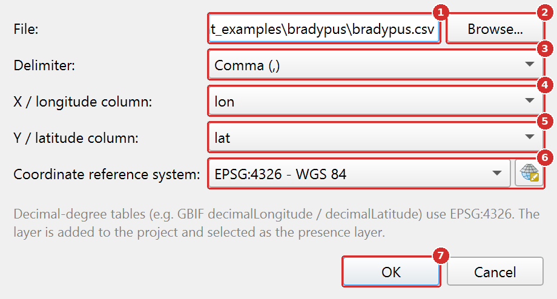{ .qm-shot width="460" }

1. **File**: the path of the table.
2. **Browse...** chooses the file.
3. **Delimiter** is detected for you. Change it only if the columns look
   wrong.
4. **X / longitude column**: the longitude or easting column.
5. **Y / latitude column**: the latitude or northing column. QMaxent
   guesses both from the column names (for example `lon`/`lat`, `x`/`y`).
6. **Coordinate reference system**: the CRS of the numbers in the table.
   Use EPSG:4326 for decimal degrees.
7. Click **OK**. The table is added to the project as a point layer.

### Step 3. Add the environmental rasters

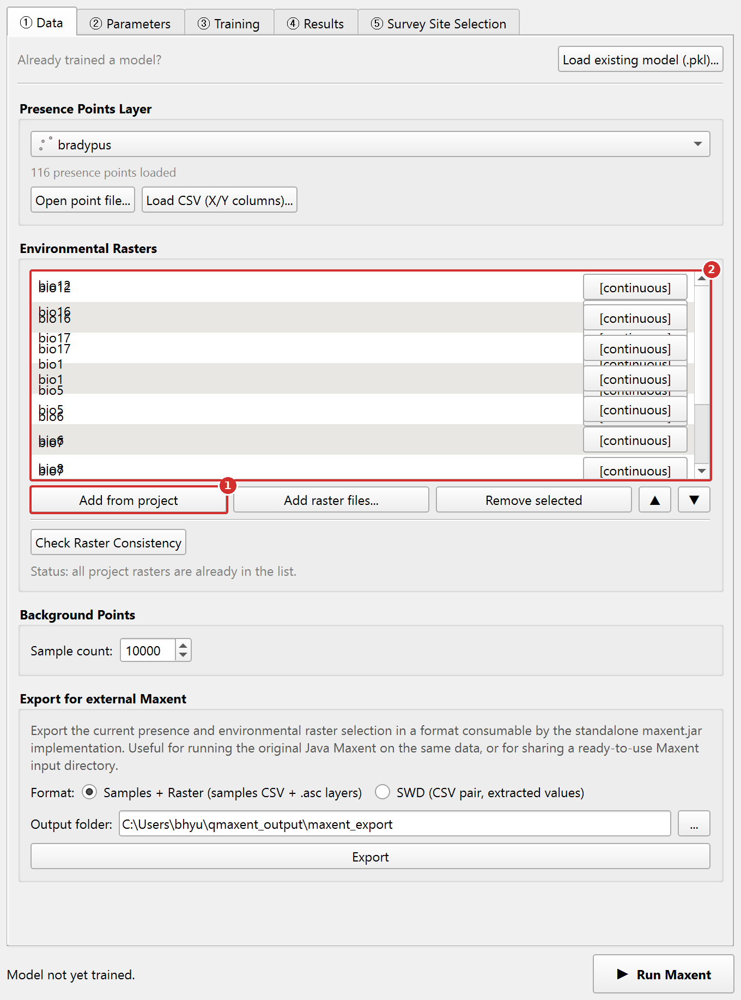{ .qm-shot width="680" }

1. **Add from project** puts every raster layer of the project in the
   list. **Add raster files...** adds rasters straight from disk.
2. Each row has a type button. `[continuous]` is for measured amounts
   such as temperature; `[categorical]` is for class codes such as land
   cover or biome. Click the button to switch. Use **Remove selected** and
   the **▲ ▼** buttons to remove rows or change their order.

### Step 4. Check that the rasters line up

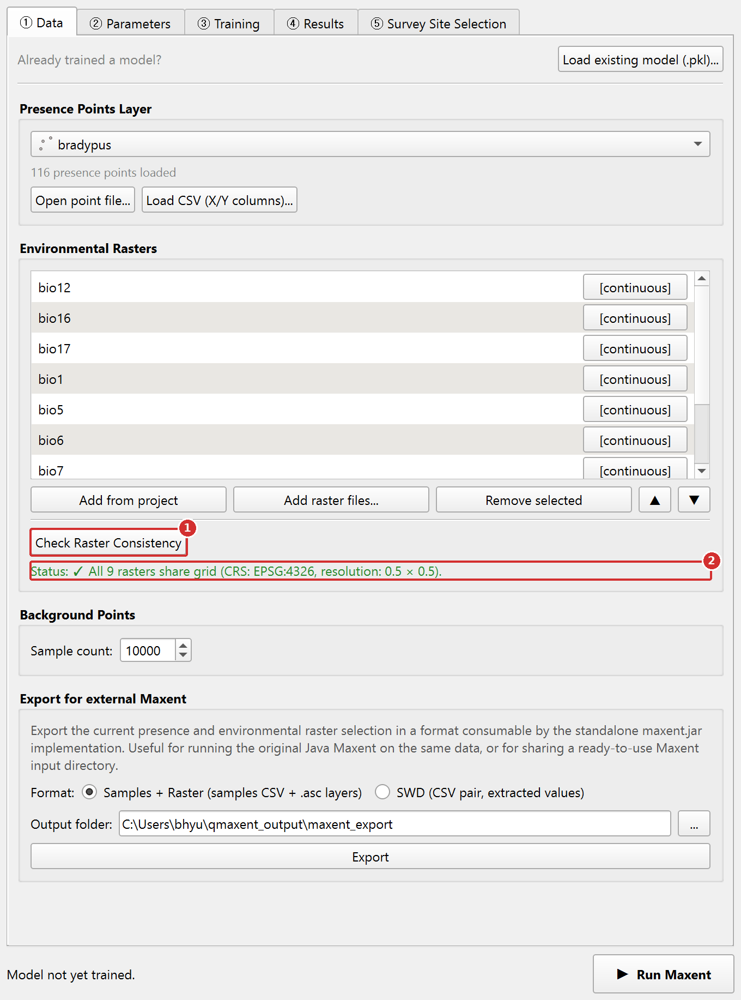{ .qm-shot width="680" }

1. Click **Check Raster Consistency**.
2. A green status line means every raster has the same CRS, extent and
   resolution. A red line means they differ; see
   [Fixing rasters that do not line up](#fixing-rasters-that-do-not-line-up).

### Step 5. Check the background points

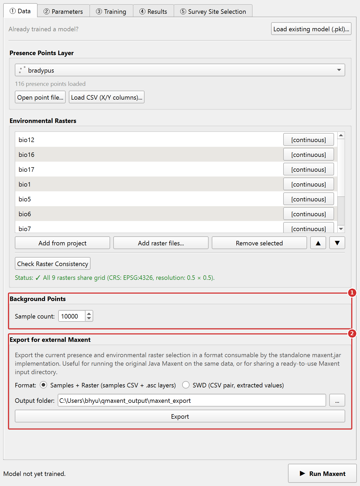{ .qm-shot width="680" }

1. **Background Points**: **Sample count** is the number of random
   background points (10,000 by default). See
   [Background points](#background-points) below.
2. **Export for external Maxent** is optional. It writes the same data
   for the Java Maxent program (see
   [Export for external Maxent](#export-for-external-maxent)).

When these steps are done, go to the [② Parameters tab](parameters-tab.md).

## Presence Points Layer

The first drop-down lists every loaded vector point layer in the current
QGIS project. Pick the layer that contains your species occurrence records.
QMaxent reads the geometry and reports the count beside the selector
(e.g. `116 presence points loaded`).

If the records are not in the project yet, two buttons below the
drop-down load them without a detour through the QGIS menus. The new
layer is added to the project and selected as the presence layer.

- **Open point file...**: any point format QGIS can read (GeoPackage,
  Shapefile, GeoJSON, KML, GML, FlatGeobuf and others). A file that does
  not contain points is refused with a message.
- **Load CSV (X/Y columns)...**: a delimited table with one row per
  record, for example a GBIF download. QMaxent detects the delimiter
  (comma, semicolon, tab or pipe) and suggests the longitude/latitude or
  X/Y columns from their names (for example `decimalLongitude` and
  `decimalLatitude` in GBIF files, or `lon`/`lat`, `x`/`y`). Check the
  suggested columns and choose the coordinate reference system of the
  coordinates. The default is EPSG:4326, which is correct for
  decimal-degree tables.

Tips for preparing this layer:

- **Geometry** must be `Point` or `MultiPoint`. Lines and polygons must be
  converted to centroids first via **Vector → Geometry Tools → Centroids…**.
- **CRS** can be anything — QMaxent reprojects on the fly to match the
  raster grid. That said, a projected CRS that matches the rasters avoids a
  mid-run reprojection step.
- **Duplicates and clustering** are tolerated but distort the model.
  maxent.jar keeps one presence per raster cell by default; QMaxent keeps
  all records, and the [③ Training tab](training-tab.md) log reports how
  many share a cell. Reduce the records to one per cell or apply
  **spatial thinning** before modeling
  ([Boria et al. 2014](references.md)), for example with the standalone
  tool *spThin*. Records with identical coordinates can also be removed
  with `Vector → Geoprocessing Tools → Delete Duplicate Geometries`.
- **Very large presence sets** (hundreds of thousands of points) are
  usually dominated by such duplicates and need several GB of memory per
  model fit (about 4 GB for 100,000 points in our tests). Thin them first;
  the model rarely changes once each occupied cell is represented once.

## Environmental rasters

Two buttons populate the raster list:

- **Add from project**: adds every raster layer currently loaded in the
  QGIS project. The fastest way to start.
- **Add raster files...**: opens a multi-select file dialog for any
  single-band raster GDAL can read (GeoTIFF, ESRI ASCII `.asc`, `.grd`,
  ERDAS `.img`, VRT, NetCDF and others). The files are added to the QGIS
  project and to the list in one step.

The list follows the QGIS project: when a raster layer is removed from
the project (or you open another project), its row disappears from the
list and the status line asks you to run **Check Raster Consistency**
again. Use the ▲ and ▼ buttons to change the order of the rows. The order
matters for reproducibility, because background points are drawn from
the first raster in the list (see [Background points](#background-points)).

QMaxent uses **one band per environmental variable**. A multi-band
raster (for example a stack of all bioclimatic variables in one file) is
refused when you click **▶ Run Maxent**, with the names of the affected
files. Split it into single-band files first, for example with
**Processing > GDAL > Raster conversion > Rearrange bands** (one band per
output), then add the single-band files.

Each row in the raster list shows the file name and a `[continuous]` /
`[categorical]` tag. **Categorical detection is automatic** when the file
carries a PAM (`.aux.xml`) sidecar with the metadata key
`LAYER_TYPE=thematic`. Without that tag, click the tag button of a row to
switch it between `[continuous]` and `[categorical]`.

!!! tip "Why categorical handling matters"
    Treating a categorical raster (e.g. biome, land-cover class) as
    continuous is one of the most common silent failures in operational
    SDM. Maxent will average across class codes as if they were ordinal,
    producing biologically meaningless responses. Always verify the
    `[categorical]` tag on integer-coded landscape rasters before training.

## Check Raster Consistency

This button runs the most important pre-flight check in the dock:
do all rasters share the **same CRS, extent, and resolution**?

- **✓ Pass** (green): the stack is grid-aligned and ready to model.
- **⚠ Mismatch** (amber): one or more rasters disagree.
- **Unusable CRS**: one or more rasters have a coordinate reference
  system that cannot be reprojected (see below).

When it fails, a second button — **Harmonize to Folder…** — appears.
Clicking it lets you nominate an output directory; QMaxent reprojects
every raster to the highest-resolution one in the stack
(nearest-neighbour for categoricals, bilinear for continuous variables) and
re-loads the harmonised set. The
[Ariolimax worked example](examples/ariolimax.md) walks through this in
detail.

### Rasters with an unusable CRS

Some rasters cannot be aligned at all because of their CRS. The check
reports two cases and names each affected file:

- the raster has **no CRS**, or
- the CRS is a **local (engineering) system without a datum**. This
  happens when a `.prj` file or GeoTIFF only carries the name of a
  projection, for example `NAD83(NSRS2007) / Michigan South`, and no
  datum. PROJ cannot transform such a CRS to any other CRS.

When the name matches an EPSG definition, the message suggests the
matching EPSG code. To fix it, in the QGIS **Layers** panel right-click
the raster, choose **Layer CRS > Set Layer CRS...**, select the correct
CRS (for example the suggested EPSG code), and click **Check Raster
Consistency** again. From then on, Check and **Harmonize to Folder...**
use the CRS you set in QGIS for that raster. Alternatively, write a
complete CRS into the file, for example with **Raster > Projections >
Assign Projection**. Harmonize no longer stops with a raw PROJ error in
this situation.

## Fixing rasters that do not line up

The steps below use the Ariolimax **Mismatch demo** from
[Example datasets](example-datasets.md), whose rasters were changed on
purpose.

### Step 1. Add the rasters and run the check

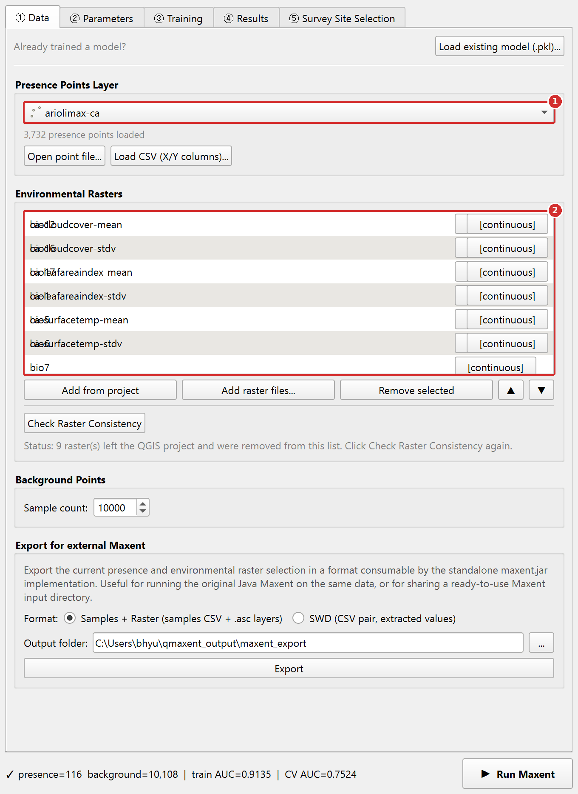{ .qm-shot width="680" }

1. Choose the presence layer.
2. Add the rasters with **Add from project**.

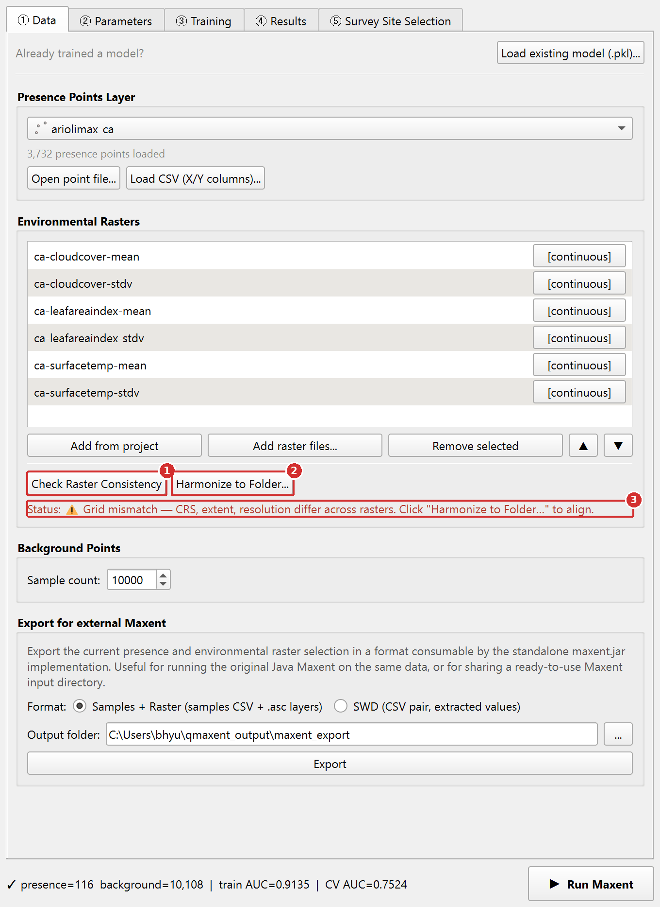{ .qm-shot width="680" }

1. Click **Check Raster Consistency**.
2. Because the grids differ, a new button **Harmonize to Folder...**
   appears. Click it.
3. The red status line names what differs (CRS, extent, resolution).

### Step 2. Choose a folder and let QMaxent align the rasters

QMaxent asks for an output folder. It proposes a `qmaxent_harmonized`
folder next to the first raster; click **Select Folder** to accept it.
The original files are never changed. A progress window follows:

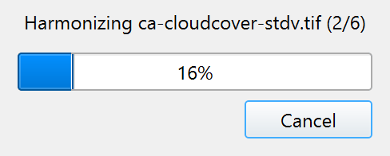{ .qm-shot width="244" }

### Step 3. Replace the rasters in the list

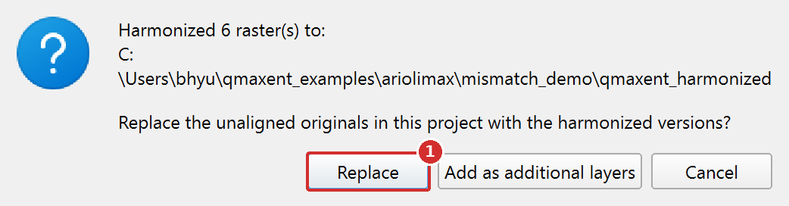{ .qm-shot width="521" }

1. Click **Replace** to use the aligned copies in place of the
   originals. **Add as additional layers** keeps both sets in the
   project.

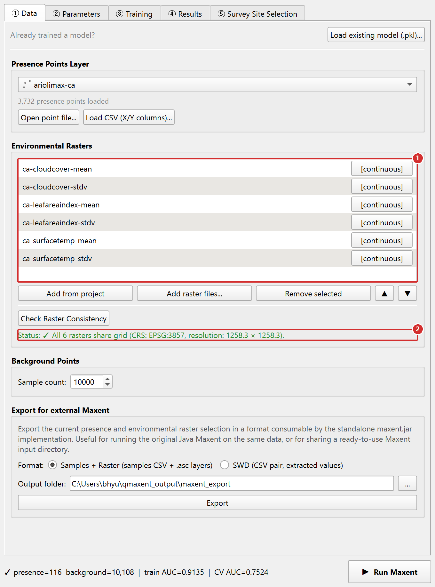{ .qm-shot width="680" }

1. The list now points to the aligned copies.
2. The status line turns green. You can continue to the
   [② Parameters tab](parameters-tab.md).

## Background points

Maxent is a **presence-background** algorithm
([Phillips et al. 2006](references.md);
[Fithian & Hastie 2013](references.md)) — it contrasts presence locations
against a background sample drawn from the rest of the study area. The
default background sample is **10,000 points** drawn at random from the
valid (non-NoData) cells of the **first raster in the list**, the value
[Phillips & Dudík 2008](references.md) recommend for typical continental-
to landscape-scale studies.

The draw is covered by **Fix random seed** on the
[② Parameters tab](parameters-tab.md): with the same seed, the same
rasters in the same order and the same presences, every run uses the
same background sample. (In v0.1.x the background was drawn anew on
every run, even with a fixed seed.) Keep the raster order unchanged when
you want to reproduce a run exactly.

You can override it in the **Background points** field. Smaller values are
appropriate only for very small study areas (<10,000 cells); larger values
rarely help and slow the run.

The **Add presences to background** checkbox is **on by default** — this
is the convention the original Java MaxEnt applies and is required for
the Maxent likelihood to be well-defined
([Phillips & Dudík 2008](references.md)).

## Export for external Maxent

This group writes your presence points and rasters in a form that the
original Java program `maxent.jar` reads, so that you can run the same
data there or share a ready-to-use Maxent input folder.

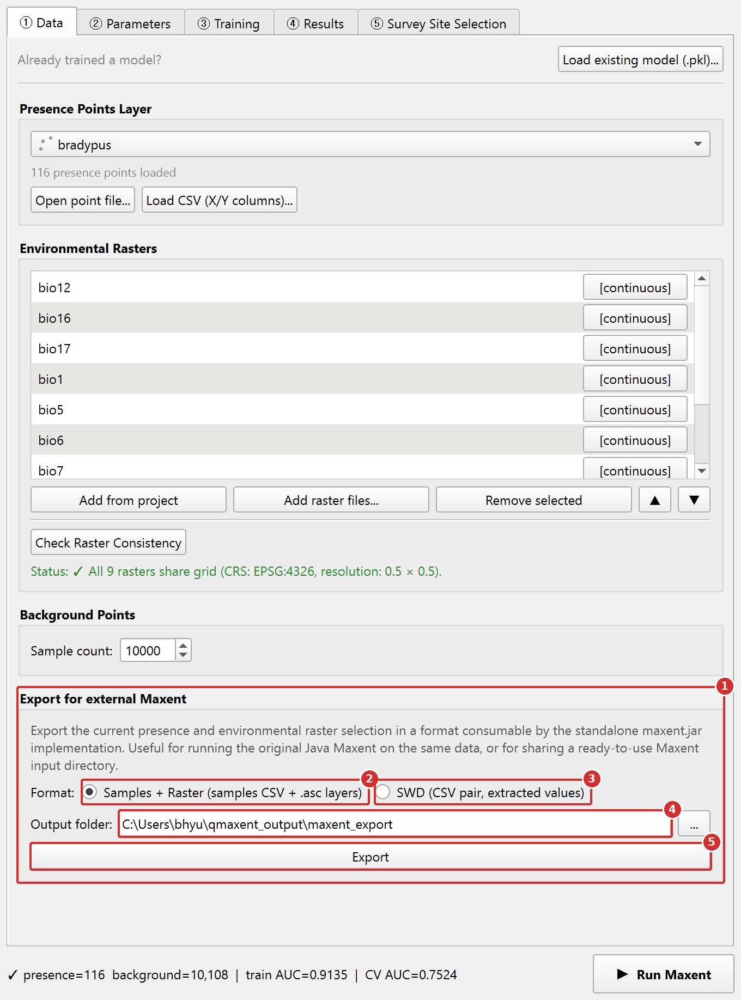{ .qm-shot width="680" }

1. The **Export for external Maxent** group.
2. **Samples + Raster** writes a samples CSV and one `.asc` grid per
   raster.
3. **SWD** writes two CSV files with the raster values already
   extracted at the presence and background points ("samples with
   data").
4. **Output folder**: where the files go. Click **...** to change it.
5. Click **Export**. A `README` with an example `maxent.jar` command is
   written next to the files.

## Load existing model (.pkl)…

The bottom of the tab has a **Load existing model (.pkl)…** button for
re-using a previously trained model on new rasters. Picking a `.pkl` opens
a variable-mapping dialog so you can re-state which raster maps to which
saved variable name — a safeguard against silent ordering errors when
collaborators use different file names. See
[Saving and reusing models](saving-models.md) for the full workflow and
the security note on Python pickle files.

## Status line

The bottom of the dock shows a one-line summary:
`presence=N background=M train AUC=… CV AUC=…`. The AUC fields populate
after the **③ Training** tab finishes a run — they let you tell at a
glance whether the dock state matches the most recent training.
