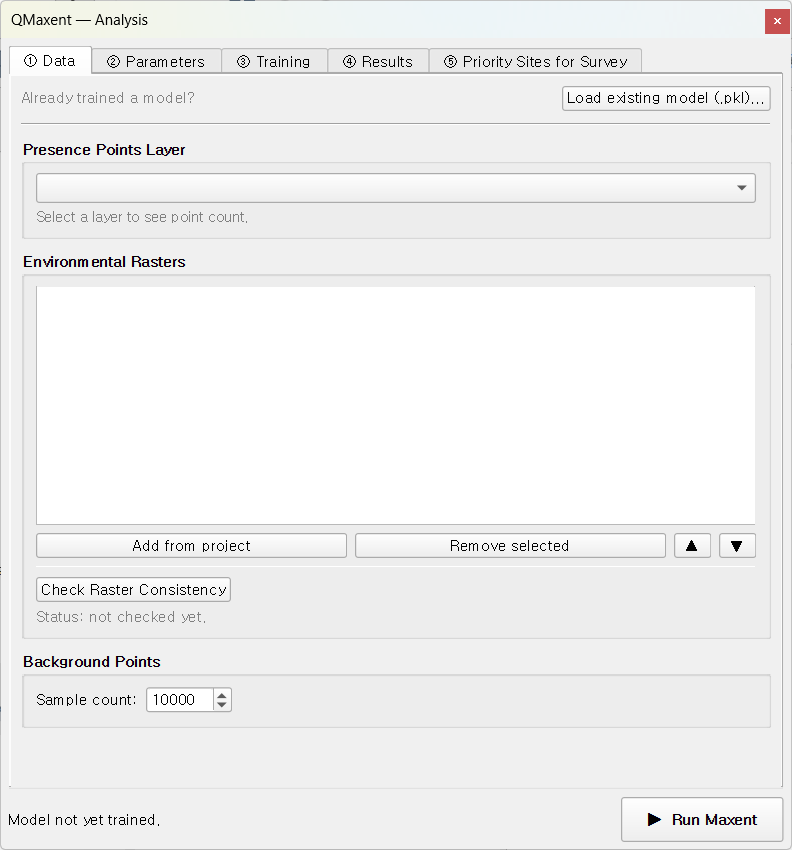
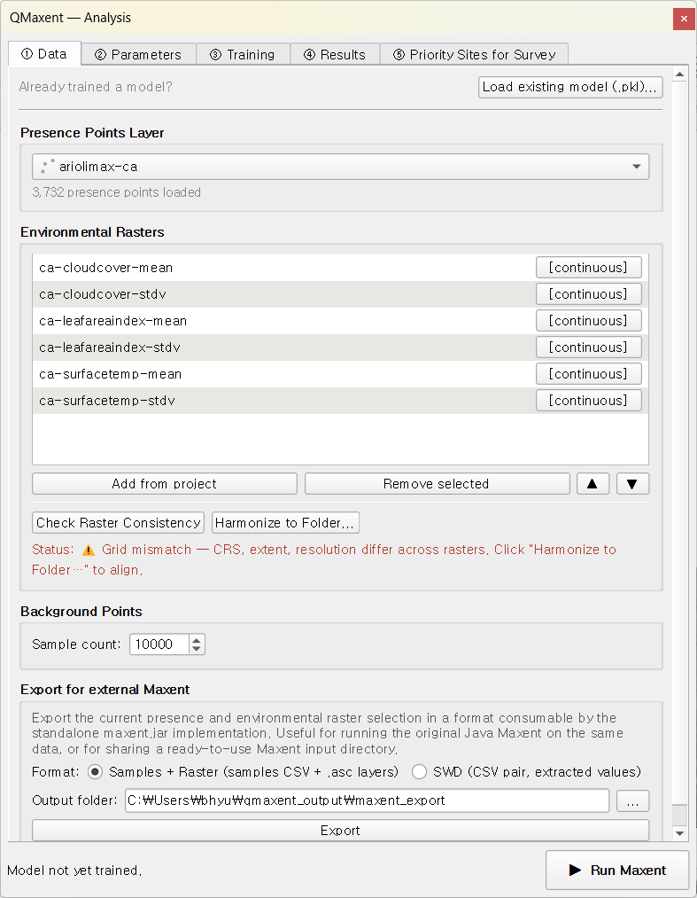
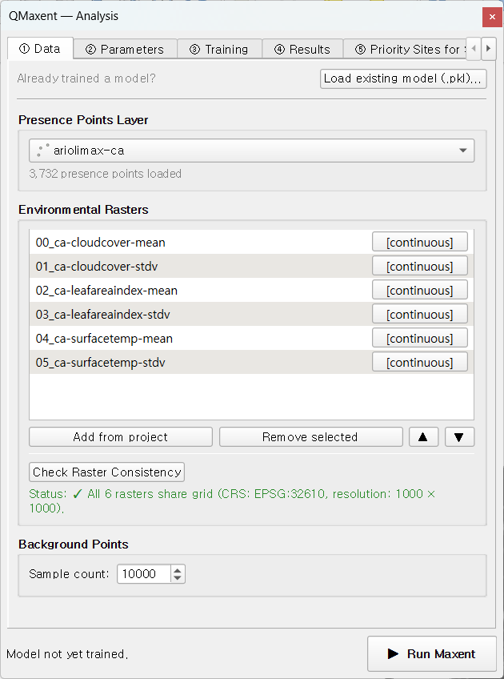

# ① Data tab

The Data tab is where you tell QMaxent **which species** you are modeling and
**which environmental variables** to use. Three controls deserve attention:
the presence-points selector, the environmental-raster list with its
**Check Raster Consistency** action, and the background-points sample size.

## Presence Points Layer

The first drop-down lists every loaded vector point layer in the current
QGIS project. Pick the layer that contains your species occurrence records.
QMaxent reads the geometry and reports the count beside the selector
(e.g. `116 presence points loaded`).

If the records are not in the project yet, two buttons below the
drop-down load them without a detour through the QGIS menus. The new
layer is added to the project and selected as the presence layer.

- **Open point file...**: any point format QGIS can read (GeoPackage,
  Shapefile, GeoJSON, KML, GML, FlatGeobuf and others). A file that does
  not contain points is refused with a message.
- **Load CSV (X/Y columns)...**: a delimited table with one row per
  record, for example a GBIF download. QMaxent detects the delimiter
  (comma, semicolon, tab or pipe) and suggests the longitude/latitude or
  X/Y columns from their names (for example `decimalLongitude` and
  `decimalLatitude` in GBIF files, or `lon`/`lat`, `x`/`y`). Check the
  suggested columns and choose the coordinate reference system of the
  coordinates. The default is EPSG:4326, which is correct for
  decimal-degree tables.

Tips for preparing this layer:

- **Geometry** must be `Point` or `MultiPoint`. Lines and polygons must be
  converted to centroids first via **Vector → Geometry Tools → Centroids…**.
- **CRS** can be anything — QMaxent reprojects on the fly to match the
  raster grid. That said, a projected CRS that matches the rasters avoids a
  mid-run reprojection step.
- **Duplicates and clustering** are tolerated but distort the model.
  [Boria et al. 2014](references.md) recommend **spatial thinning** before
  modeling; consider running QGIS plugin *NNJoin* or the standalone tool
  *spThin* before using QMaxent.

## Environmental rasters

Two buttons populate the raster list:

- **Add from project**: adds every raster layer currently loaded in the
  QGIS project. The fastest way to start.
- **Add raster files...**: opens a multi-select file dialog for any
  single-band raster GDAL can read (GeoTIFF, ESRI ASCII `.asc`, `.grd`,
  ERDAS `.img`, VRT, NetCDF and others). The files are added to the QGIS
  project and to the list in one step.

The list follows the QGIS project: when a raster layer is removed from
the project (or you open another project), its row disappears from the
list and the status line asks you to run **Check Raster Consistency**
again. Use the ▲ and ▼ buttons to change the order of the rows. The order
matters for reproducibility, because background points are drawn from
the first raster in the list (see [Background points](#background-points)).

QMaxent uses **one band per environmental variable**. A multi-band
raster (for example a stack of all bioclimatic variables in one file) is
refused when you click **▶ Run Maxent**, with the names of the affected
files. Split it into single-band files first, for example with
**Processing > GDAL > Raster conversion > Rearrange bands** (one band per
output), then add the single-band files.

Each row in the raster list shows the file name and a `[continuous]` /
`[categorical]` tag. **Categorical detection is automatic** when the file
carries a PAM (`.aux.xml`) sidecar with the metadata key
`LAYER_TYPE=thematic`. Without that tag, click the tag button of a row to
switch it between `[continuous]` and `[categorical]`.

!!! tip "Why categorical handling matters"
    Treating a categorical raster (e.g. biome, land-cover class) as
    continuous is one of the most common silent failures in operational
    SDM. Maxent will average across class codes as if they were ordinal,
    producing biologically meaningless responses. Always verify the
    `[categorical]` tag on integer-coded landscape rasters before training.

## Check Raster Consistency

This button runs the most important pre-flight check in the dock:
do all rasters share the **same CRS, extent, and resolution**?

- **✓ Pass** (green): the stack is grid-aligned and ready to model.
- **⚠ Mismatch** (amber): one or more rasters disagree.
- **Unusable CRS**: one or more rasters have a coordinate reference
  system that cannot be reprojected (see below).

When it fails, a second button — **Harmonize to Folder…** — appears.
Clicking it lets you nominate an output directory; QMaxent reprojects
every raster to the highest-resolution one in the stack
(nearest-neighbour for categoricals, bilinear for continuous variables) and
re-loads the harmonised set. The
[Ariolimax worked example](examples/ariolimax.md) walks through this in
detail.

### Rasters with an unusable CRS

Some rasters cannot be aligned at all because of their CRS. The check
reports two cases and names each affected file:

- the raster has **no CRS**, or
- the CRS is a **local (engineering) system without a datum**. This
  happens when a `.prj` file or GeoTIFF only carries the name of a
  projection, for example `NAD83(NSRS2007) / Michigan South`, and no
  datum. PROJ cannot transform such a CRS to any other CRS.

When the name matches an EPSG definition, the message suggests the
matching EPSG code. To fix it, in the QGIS **Layers** panel right-click
the raster, choose **Layer CRS > Set Layer CRS...**, select the correct
CRS (for example the suggested EPSG code), and click **Check Raster
Consistency** again. From then on, Check and **Harmonize to Folder...**
use the CRS you set in QGIS for that raster. Alternatively, write a
complete CRS into the file, for example with **Raster > Projections >
Assign Projection**. Harmonize no longer stops with a raw PROJ error in
this situation.

## Background points

Maxent is a **presence-background** algorithm
([Phillips et al. 2006](references.md);
[Fithian & Hastie 2013](references.md)) — it contrasts presence locations
against a background sample drawn from the rest of the study area. The
default background sample is **10,000 points** drawn at random from the
valid (non-NoData) cells of the **first raster in the list**, the value
[Phillips & Dudík 2008](references.md) recommend for typical continental-
to landscape-scale studies.

The draw is covered by **Fix random seed** on the
[② Parameters tab](parameters-tab.md): with the same seed, the same
rasters in the same order and the same presences, every run uses the
same background sample. (In v0.1.x the background was drawn anew on
every run, even with a fixed seed.) Keep the raster order unchanged when
you want to reproduce a run exactly.

You can override it in the **Background points** field. Smaller values are
appropriate only for very small study areas (<10,000 cells); larger values
rarely help and slow the run.

The **Add presences to background** checkbox is **on by default** — this
is the convention the original Java MaxEnt applies and is required for
the Maxent likelihood to be well-defined
([Phillips & Dudík 2008](references.md)).

## Load existing model (.pkl)…

The bottom of the tab has a **Load existing model (.pkl)…** button for
re-using a previously trained model on new rasters. Picking a `.pkl` opens
a variable-mapping dialog so you can re-state which raster maps to which
saved variable name — a safeguard against silent ordering errors when
collaborators use different file names. See
[Saving and reusing models](saving-models.md) for the full workflow and
the security note on Python pickle files.

## Status line

The bottom of the dock shows a one-line summary:
`presence=N background=M train AUC=… CV AUC=…`. The AUC fields populate
after the **③ Training** tab finishes a run — they let you tell at a
glance whether the dock state matches the most recent training.
