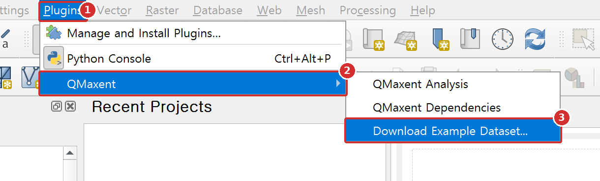
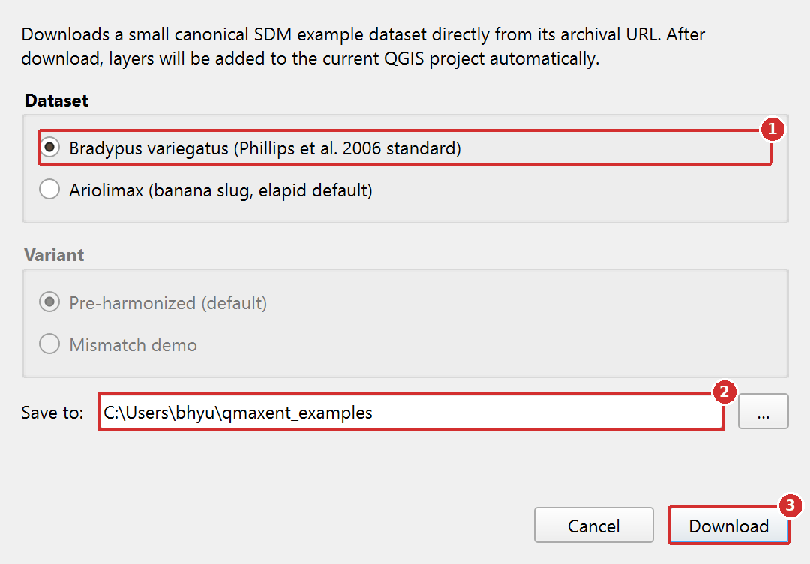
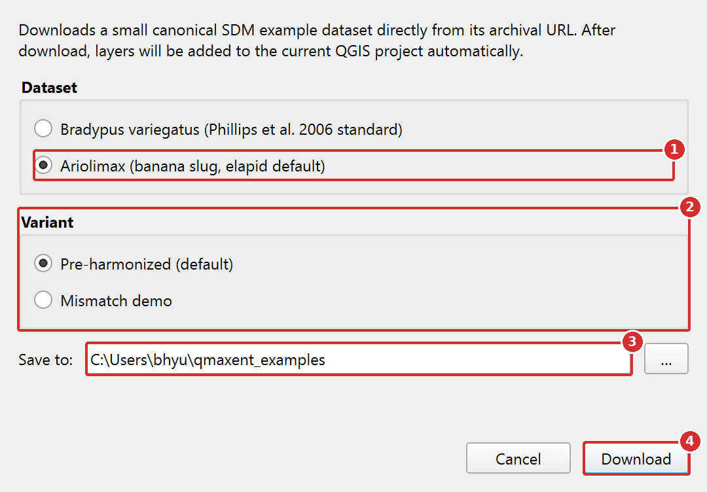
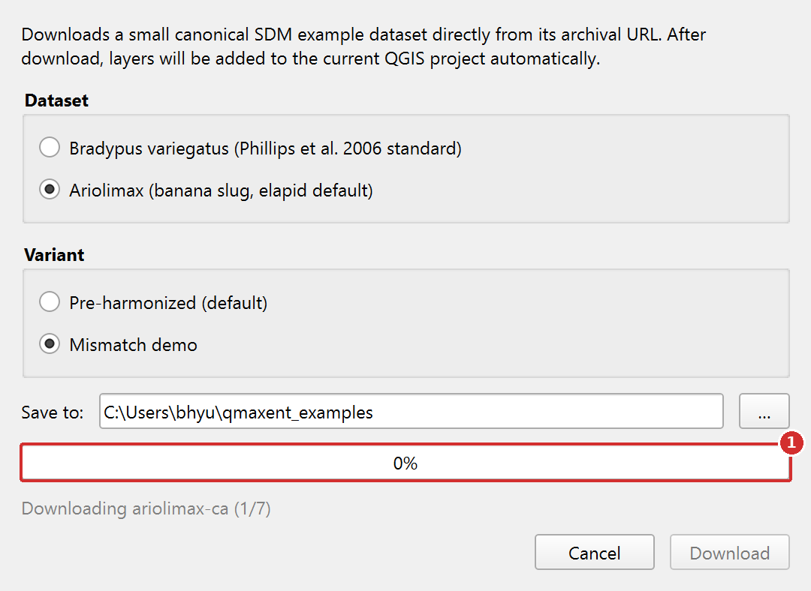
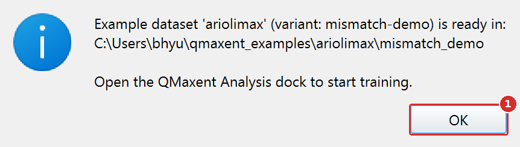
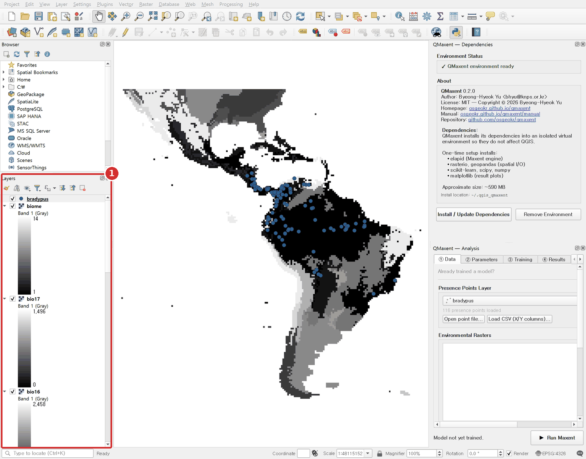

# Example datasets

QMaxent ships a one-click downloader for two canonical SDM example
datasets, accessed from **Plugins → QMaxent → Download Example Dataset...**
They are the same datasets the broader Maxent literature has used for
almost two decades, which means you can compare your results directly
with published benchmarks.

## Step by step

### Step 1. Open the downloader

{ .qm-shot width="610" }

1. Open the **Plugins** menu.
2. Point to **QMaxent**.
3. Click **Download Example Dataset...**

### Step 2. Choose a dataset and a folder

{ .qm-shot width="540" }

1. Choose the dataset. **Bradypus variegatus** is the best one to start
   with.
2. Check **Save to**. The default is a `qmaxent_examples` folder in your
   home folder. Click **...** to choose another folder.
3. Click **Download**.

For **Ariolimax**, the dialog also offers a **Variant**:

{ .qm-shot width="540" }

1. Select **Ariolimax**.
2. **Variant**: **Pre-harmonized (default)** loads the rasters as
   published, all on one grid. **Mismatch demo** loads copies whose CRS,
   extent and resolution were changed on purpose, so that you can
   practise the raster consistency check (see
   [Fixing rasters that do not line up](data-tab.md#fixing-rasters-that-do-not-line-up)).
3. **Save to** works as for Bradypus.
4. Click **Download**.

### Step 3. Wait for the download

{ .qm-shot width="540" }

1. The progress bar and the line below it show which file is being
   downloaded. Click **Cancel** to stop.

When the download ends, a message tells you where the files are:

{ .qm-shot width="431" }

1. Click **OK**.

### Step 4. Check the layers

{ .qm-shot width="1440" }

1. The presence layer and the environmental rasters are added to the
   **Layers** panel and drawn on the map. You can go straight to the
   [Quick start](quick-start.md).

## Bradypus variegatus dataset

*The brown-throated three-toed sloth*. This is the canonical Maxent test
dataset published with Phillips, Anderson & Schapire (2006) and reused
in virtually every subsequent Maxent paper.

| Layer | Description |
|---|---|
| `bradypus.shp` | 116 presence points across South and Central America |
| `bio1, bio5, bio6, bio7, bio8, bio12, bio16, bio17` | WorldClim bioclimatic variables (continuous) |
| `biome` | Biome classification (categorical) |

After download the layers appear immediately in the QGIS canvas:


The dataset is small (well under 100 MB) and the resulting Maxent runs
typically finish in under 30 seconds, so it is ideal for first runs and
for working through this manual.

## Ariolimax dataset

*The Pacific banana slug*. This is the default test dataset that ships
with [elapid](https://github.com/earth-chris/elapid).

!!! note "Pre-harmonized or Mismatch demo?"

    The published Ariolimax rasters already share one CRS, extent and
    resolution, so **Check Raster Consistency** passes at once. Choose
    **Mismatch demo** in the **Variant** box when you want to see and fix
    a grid mismatch, as in the
    [Ariolimax worked example](examples/ariolimax.md). The demo copies
    are written to a `mismatch_demo` subfolder; the original files stay
    unchanged.

## Save location and project structure

Whichever dataset you choose, the downloader creates a sub-folder named
after the species:

```text
qmaxent_examples/
├── bradypus/
│   ├── bradypus.shp     (and .dbf, .shx, .prj, .cpg)
│   ├── bio1.tif         …
│   └── biome.tif
└── ariolimax/
    ├── ariolimax.shp
    └── …
```

Re-running the dialog with the same Save-to path overwrites previously
downloaded files, so it is safe to use as a "reset to defaults" button if
you want to start a tutorial cleanly.

## Loading the layers manually

The plugin auto-adds layers, but if you ever need to reload them by hand,
just drag the `.shp` and `.tif` files from QGIS's **Browser** panel into
the **Layers** panel — exactly as you would for any other dataset.

## Where the data comes from

Both datasets are pulled from their canonical archival URLs at download
time; QMaxent does not ship them inside the plugin itself. This keeps
the plugin package small and ensures you always get the upstream-canonical
version. If you need offline access, run the downloader once on a
connected machine and copy the `qmaxent_examples` folder onto offline
workstations.

Copies of both datasets are also kept in the
[`example_data`](https://github.com/osgeokr/qmaxent/tree/main/example_data) folder of the QMaxent repository (about
15 MB). The files are unchanged copies of the originals, and
`README.txt` lists their sources and citations. Download the files and
add the layers to a QGIS project.
