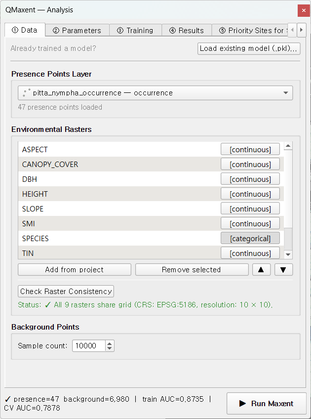
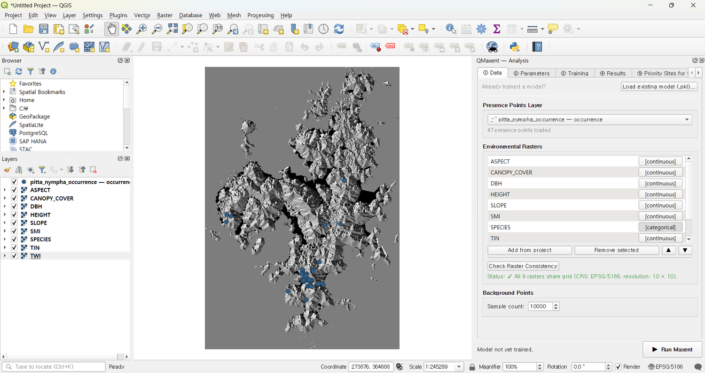
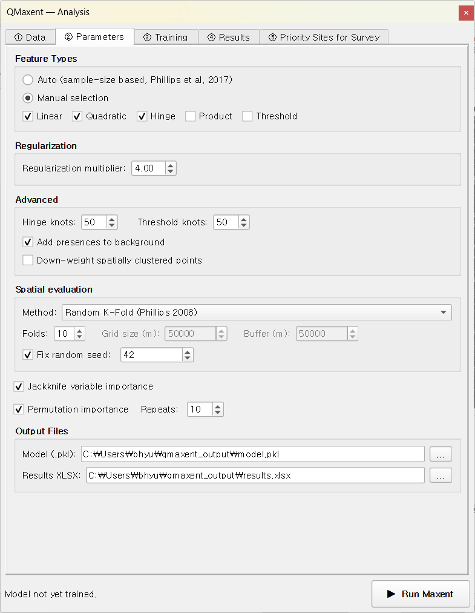
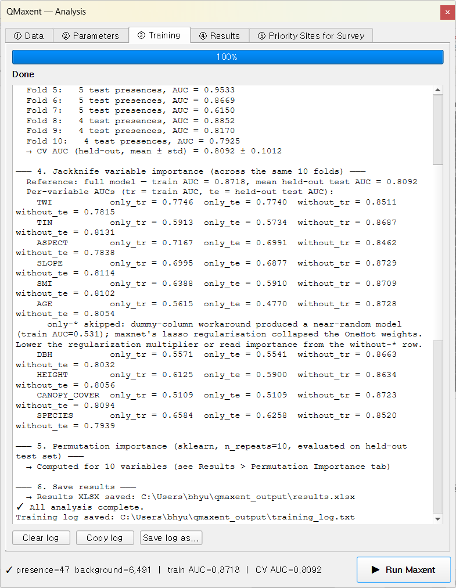
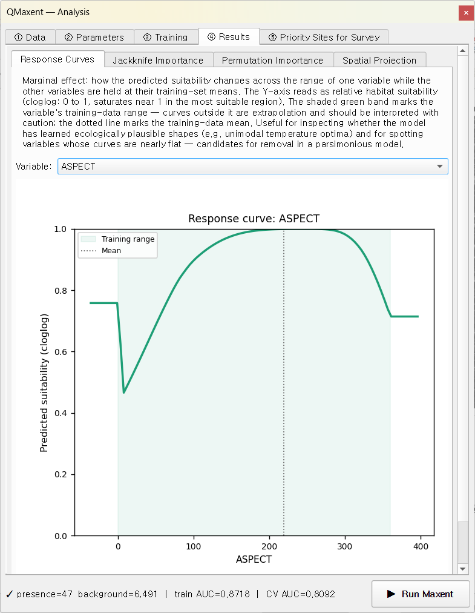
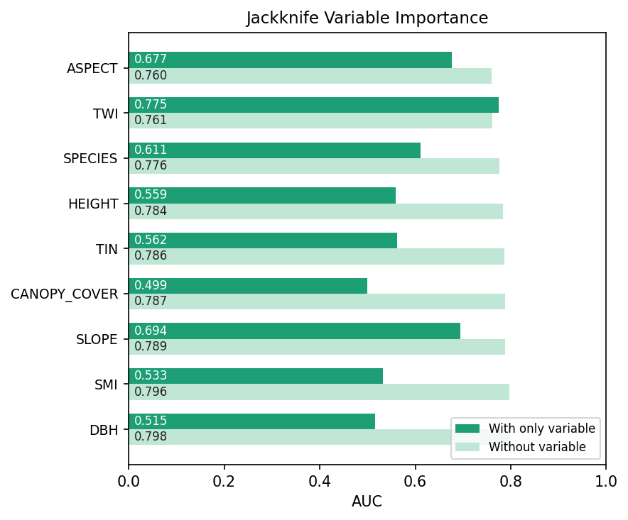
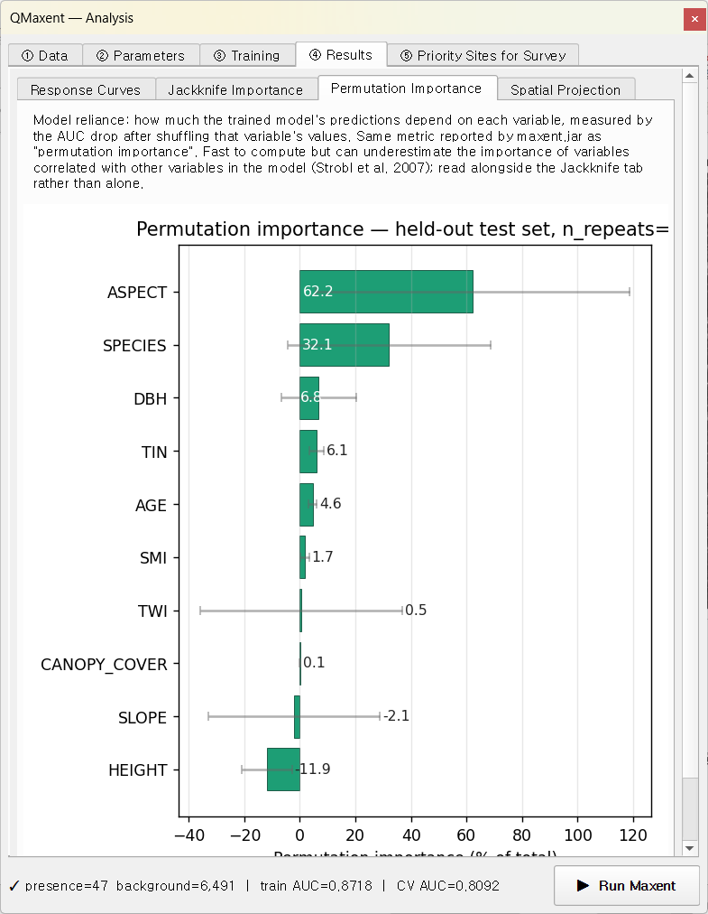
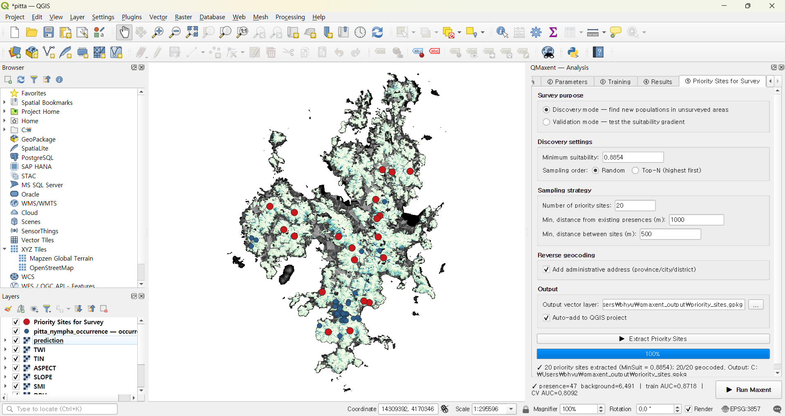

# Pitta nympha

The fairy pitta *Pitta nympha* is a long-distance migratory passerine
that breeds in dense, multi-strata broadleaved forest. The dataset
used here comes from a published field study, Lee et al. (2025,
*Global Ecology and Conservation* 64:e03939), which surveyed nest
sites on Geoje Island (Geoje-si, South Korea), selected Maxent
settings with ENMeval and fitted the final model with linear,
quadratic and hinge features (LQH) and a regularization multiplier of
4. Re-running the same data in QMaxent serves two purposes:

1. **Worked example for real, small-n field data** (47 nest locations)
   with a mix of continuous topographic and forest-structure variables
   and two categorical variables.
2. **Cross-implementation comparison** with maxent.jar on identical
   inputs, at the default regularization (β = 1) and at the settings of
   Lee et al. (β = 4). See [§ 7](#7-comparison-with-maxentjar) below.

## 1. Dataset

The ten covariates are those of Lee et al. (2025, Table 1):

| Layer | Type | Description |
|---|---|---|
| `pitta_nympha_occurrence` | Vector point | **47** nest locations on Geoje Island |
| `TWI` | Continuous raster | Topographic wetness index |
| `TIN` | Continuous raster | Elevation |
| `ASPECT` | Continuous raster | Aspect |
| `SLOPE` | Continuous raster | Slope (°) |
| `SMI` | Continuous raster | Soil moisture index |
| `DBH` | Continuous raster | Mean trunk diameter at breast height |
| `HEIGHT` | Continuous raster | Mean tree height |
| `AGE` | **Categorical** raster | Forest age class |
| `CANOPY_COVER` | Continuous raster | Canopy closure (%) |
| `SPECIES` | **Categorical** raster | Dominant tree species (class code) |

All ten rasters share a common grid (EPSG:5186 KGD2002 / Central
Belt, 10 m × 10 m). This is real survey data: the dataset is not
bundled with the plugin's Example Dataset Downloader; the
corresponding author of the manuscript holds the canonical copy
(contact bhyu@knps.or.kr).

## 2. Loading data

On **① Data**, pick `pitta_nympha_occurrence` from the Presence
Points Layer drop-down (47 points), add all ten rasters from the
project, **mark `AGE` and `SPECIES` as `[categorical]`**, and click
**Check Raster Consistency**:

The status line reads
`✓ All 10 rasters share grid (CRS: EPSG:5186, resolution: 10 × 10)`.
The presence points cluster on Geoje Island's central forested
ridges:

Keep the raster order unchanged between runs: background points are
drawn from the first raster in the list, so the order is part of what
makes a run reproducible.

## 3. Lee-matched parameters

On **② Parameters**, switch to **Manual selection** for Feature
Types and tick **Linear**, **Quadratic**, **Hinge** (untick
Product and Threshold). Set **Regularization multiplier = 4.00**.
For Spatial evaluation, choose **Random K-Fold (Phillips 2006)**
with **Folds = 10**, and leave **Fix random seed** on with the value
42. Leave Jackknife and Permutation importance enabled (10 repeats,
**Evaluate on: Training data (maxent.jar convention)**):

This is the configuration that ENMeval selected in Lee et al. (2025).
Note that **Auto (maxnet default rule by sample size)** would also give
LQH for 47 presences (15 to 79 presences); the manual selection makes
the choice explicit. Lee et al. evaluated the final model with ten
random 75/25 splits of the presences; random 10-fold CV is the closest
option in QMaxent.

## 4. Training

Click **▶ Run Maxent**. The Training tab finishes in ~ 20 seconds:

With the fixed seed, QMaxent v0.2.0 uses 47 presences and 9,384
background points. In the v0.2.0 re-analysis:

- **Full-data model**: training AUC = 0.8645.
- **Cross-validation**: Random K-Fold n=10, seed=42, CV AUC =
  **0.812 ± 0.110** (mean ± SD across folds). The per-fold AUCs spread
  widely, reflecting the small sample (4–5 test presences per fold)
  typical of field-survey datasets.

The table below shows how the CV AUC depends on the regularization
multiplier and on the partition (QMaxent v0.2.0, mean ± SD across folds):

| β | Random 10-fold | Geographic 5-fold |
|---|---|---|
| 1 | 0.805 ± 0.108 | 0.713 ± 0.138 |
| 4 | 0.812 ± 0.110 | 0.739 ± 0.134 |

Geographic folds give lower AUCs than random folds, as expected when
the test presences are spatially separated from the training presences
([Roberts et al. 2017](../references.md)). The stronger regularization
of β = 4 helps slightly under both partitions.

### Jackknife with a categorical variable

The log can surface a diagnostic that does not appear in the
Bradypus / Ariolimax runs:

> `only-*` skipped: dummy-column workaround produced a near-random
> model (train AUC = 0.531); maxnet's lasso regularisation collapsed
> the OneHot weights. Lower the regularization multiplier or read
> importance from the `without-*` row.

In the *only-this-variable* jackknife pass a categorical variable such
as `AGE` must be one-hot encoded, but at β = 4 the L1 lasso penalty can
collapse every OneHot weight back to near-zero, and Maxent has nothing
left to score with. QMaxent detects this collapse, skips the affected
`only-*` row, and tells you in plain English. The `without-*` row
remains informative and is the right place to read the variable's
incremental contribution.

This is exactly the over-regularisation failure mode
[Merow et al. 2013](../references.md) describe. A β = 1 run
recovers a meaningful `only-*` AUC.

## 5. Variable behaviour

### Response curve — `ASPECT`

The model assigns highest suitability to north-facing aspects
(roughly 270°–360°), consistent with the fairy pitta's known
preference for shaded, cool, humid microclimates on ridge shoulders.

### Jackknife importance

`ASPECT`, `TWI`, and `SPECIES` carry the strongest *without-row*
signals: removing them costs the most. A skipped `only-*` bar means
the collapse described in § 4 above occurred; read that variable's
`without-*` bar instead.

### Permutation importance

The permutation pass shuffles each variable in the fitted model, so it
is not affected by the lasso collapse that can disable a categorical
variable's `only-*` jackknife row, and all ten variables get a
comparable percentage:

With **Evaluate on: Training data (maxent.jar convention)** the ranking
is computed the same way as in maxent.jar and in Lee et al. (2025).
`TWI`, `ASPECT` and `SPECIES` are the top three variables in QMaxent, in
maxent.jar and in Lee et al. (2025, Table 4); see § 7.

## 6. Survey site selection

After projection, the **⑤ Survey Site Selection** tab in
**High-suitability search** mode produces field-trip candidates on
Geoje. With **Minimum suitability** at its automatic value of 0.900
(0.9 × the raster maximum), **Sampling order: Random**, 20 sites, at
least 1,000 m from known nests and at least 500 m apart, QMaxent
returns a tractable list of twenty new search locations:

Reverse geocoding fills the `country`, `province`, `city_county` and
`district` fields from OpenStreetMap. With **Address language: Local
names** (the default) the names are in Korean; choose **English** for
English names. A level that OpenStreetMap does not hold for a location
is left blank. This is a one-step path from model to field-trip
planning.

## 7. Comparison with maxent.jar

The v0.2.0 re-analysis gave maxent.jar 3.4.4 and QMaxent **identical
inputs**: the same 47 presences and the same 9,384 background points
(sampled by QMaxent with seed 42 and exported in SWD format), with LQH
features. Permutation importance was evaluated on the training data in
both programs.

**Full-data fits on identical inputs**

| Setting | Training AUC, maxent.jar | Training AUC, QMaxent | Prediction correlation (Pearson r) | Permutation-importance rank agreement (Spearman ρ) |
|---|---|---|---|---|
| β = 1 (default) | 0.8795 | 0.8738 | 0.957 | 0.648 |
| β = 4 (Lee et al. settings) | 0.8520 | 0.8645 | 0.894 | 0.867 (p = 0.001) |

The two programs agree closely but not to the third decimal. elapid's
scikit-learn backend applies one regularization strength to all
features, while maxent.jar regularizes each feature class separately,
so the fitted coefficients differ somewhat. Rank agreement of the
variable importances is moderate at β = 1 and strong at β = 4.

**Lee et al. (2025) protocol**

Following the final-model protocol of Lee et al. (LQH, β = 4, ten random
75/25 splits of the presences, identical splits in both programs), the
QMaxent permutation-importance ranking agrees with Lee et al. (2025,
Table 4) at Spearman ρ = 0.830. The top three variables are the same in
maxent.jar, QMaxent and Lee et al.: `TWI`, `ASPECT` and `SPECIES`. The
bias file of Lee et al. was not reproduced.

## 8. What this example demonstrates

1. **Real-data workflow with small-n field surveys** (47 presences,
   10 covariates, real-world spatial scale).
2. **Categorical variable handling** (`AGE`, `SPECIES`) plus the
   OneHot-collapse diagnostic when over-regularised.
3. **The Lee-matched (β = 4) configuration** and its comparison with
   maxent.jar on identical inputs (§ 7).
4. **A different, narrower kind of survey site selection**: a targeted
   search around known sub-populations rather than continental
   discovery.

The comparison values are recorded in
`tests/fixtures/pitta_golden_values.json` in the QMaxent repository.
