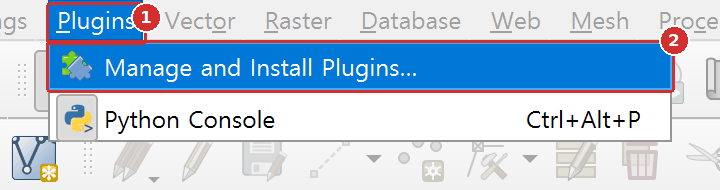
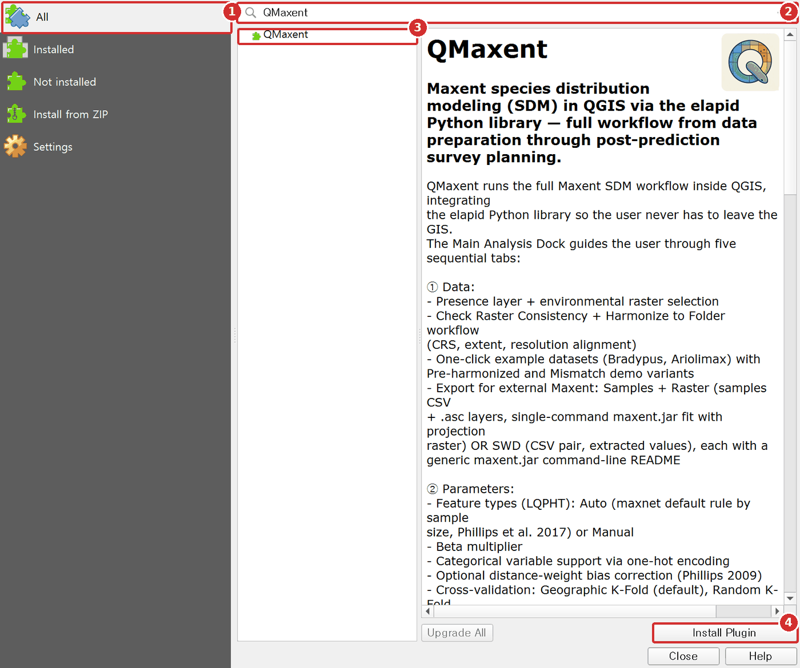
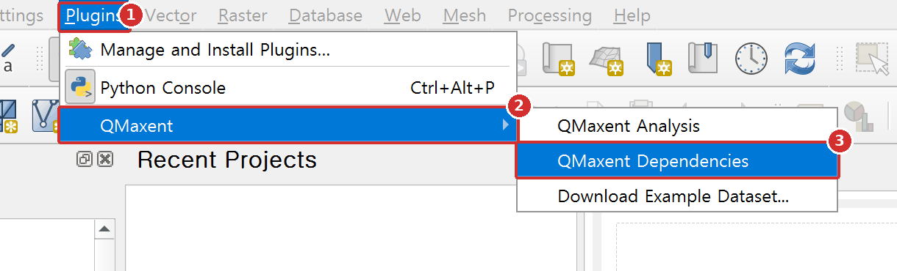
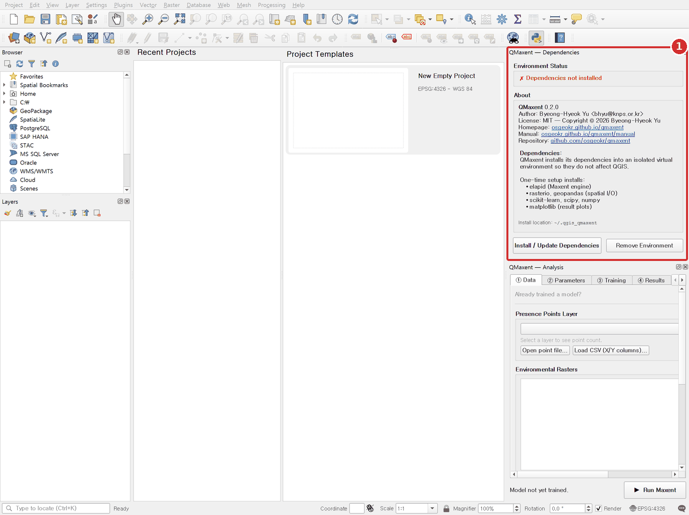

# Installation

QMaxent installs as a regular QGIS plugin. After the plugin itself is in
place, a one-time dependency setup downloads the Python libraries Maxent
needs into a separate QMaxent folder that does not affect your system
Python or QGIS itself. On Linux and macOS this folder is a Python virtual
environment; on Windows it is a plain package folder filled by the QGIS
Python's own pip (see [Dependencies](dependencies.md)).

## System requirements

- **QGIS** 3.44 LTR or later
- **Operating system**: Windows 10/11, macOS 12+, or any modern Linux distribution
- **Disk space**: about 600 MB free for the QMaxent package folder
- **Internet access** is required only on first run to download the Python
    dependencies; routine model fitting and projection run fully offline.

## Install from the QGIS Plugin Repository

QMaxent is published on the
[official QGIS Plugin Repository](https://plugins.qgis.org/plugins/qmaxent/).

### Step 1. Open the Plugin Manager

{ .qm-shot width="360" }

1. Open the **Plugins** menu.
2. Click **Manage and Install Plugins...**

### Step 2. Find QMaxent and install it

{ .qm-shot width="887" }

1. Make sure the **All** page is selected on the left.
2. Type `QMaxent` in the search box.
3. Click **QMaxent** in the result list. Its description appears on the
   right.
4. Click **Install Plugin**. When the installation ends, click **Close**.

### Step 3. Find the QMaxent menu

{ .qm-shot width="610" }

1. Open the **Plugins** menu again.
2. Point to **QMaxent**. Three entries appear.
3. **QMaxent Dependencies** opens the dependency setup described in the
   next chapter.

| Menu item | What it does |
|---|---|
| **QMaxent Analysis** | Opens the Analysis dock, where all modelling happens |
| **QMaxent Dependencies** | Opens the dependency setup (next chapter) |
| **Download Example Dataset...** | Downloads the example data used in this manual (see [Example datasets](example-datasets.md)) |

## Verifying the installation

Right after the installation, QMaxent opens two panels on the right side
of QGIS: **QMaxent Dependencies** at the top and the **QMaxent Analysis**
dock below it.

{ .qm-shot width="1440" }

1. The **QMaxent Dependencies** panel reads *Dependencies not installed*
   the first time. That is expected: the next chapter installs them.

If the panels do not appear, choose **Plugins → QMaxent → QMaxent
Dependencies**. If that opens, the plugin is installed correctly.

## Updating to a newer version

When a new release ships, the QGIS Plugin Manager will mark QMaxent as
upgradable. Click **Upgrade Plugin** in the **Installed** tab. Dependencies
generally do not need to be reinstalled across patch releases (0.1.x →
0.1.y). When the package list or the installation method changes, the
**Dependencies** dialog reports that the dependencies need updating; click
**Install / Update Dependencies** once more. This is the case when you
upgrade to 0.2.0 on Windows, because 0.2.0 changed how packages are
installed there.

## Troubleshooting

??? warning "QMaxent does not appear in the search results"
    Make sure your QGIS version is 3.44 or later (`Help → About QGIS`).
    On older versions QMaxent is filtered out as incompatible. Also confirm
    the **Show experimental plugins** option in **Settings** is set to
    your preference — QMaxent's stable releases do not require it.

??? warning "Plugin installs but the menu entry does not appear"
    Restart QGIS. Some QGIS versions require a restart for top-level menu
    entries from new plugins to register.

??? warning "Windows: installation stops with 'ensurepip ... returned non-zero exit status 1'"
    QMaxent 0.1.x created a Python virtual environment, and this step
    fails with QGIS 3.44.15 and later on Windows. QMaxent 0.2.0 no longer
    needs a virtual environment on Windows: it installs the packages with
    the QGIS Python's own pip into the QMaxent package folder. Upgrade the
    plugin to 0.2.0 or later and click **Install / Update Dependencies**
    again. Details are in [Dependencies](dependencies.md).

??? warning "Corporate proxy or restricted network"
    The plugin install itself uses QGIS's network stack and respects
    QGIS's proxy settings. The dependency installer (next chapter)
    downloads from [PyPI](https://pypi.org); if your organisation blocks
    PyPI, ask your network administrator to allow `pypi.org` and
    `files.pythonhosted.org`.

Once installed, continue to [Dependencies](dependencies.md).
