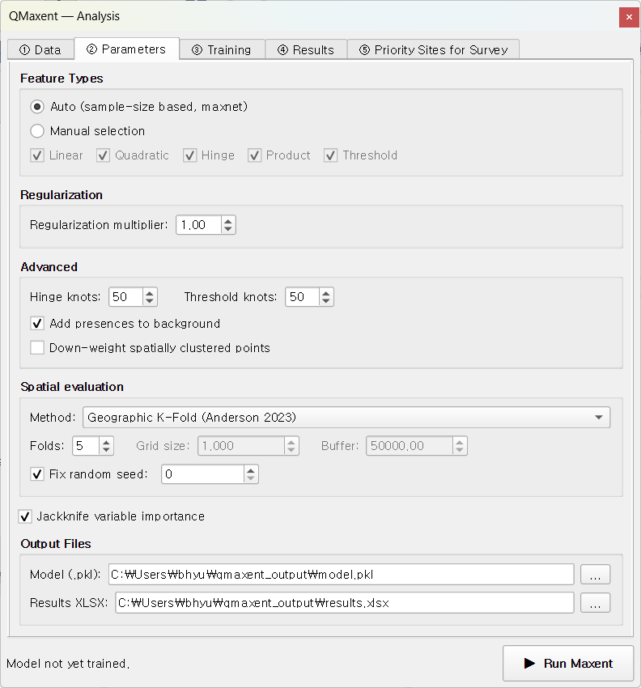
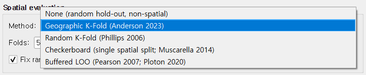

# ② Parameters tab

The Parameters tab controls the *modeling* and *evaluation* settings: which
Maxent feature classes to allow, the regularization multiplier, the spatial
cross-validation method, and where to write outputs. Defaults follow
established Maxent practice; this chapter explains what each control does
and when to override the default.

## Feature Types

Maxent's "features" are the basis functions it uses to express the response
of suitability to each environmental variable
([Phillips, Anderson & Schapire 2006](references.md);
[Phillips et al. 2017](references.md)). The five classes (LQPHT) are:

| Feature | Symbol | What it captures |
|---|---|---|
| **Linear** | `L` | Monotonic linear response |
| **Quadratic** | `Q` | Optimum-shaped (∩) or U-shaped (∪) response |
| **Product** | `P` | Pairwise interactions between two variables |
| **Hinge** | `H` | Piecewise-linear "kink" — sharp changes at threshold values |
| **Threshold** | `T` | Step-function — a hard cut-off at some value |

QMaxent offers two modes:

- **Auto (maxnet default rule by sample size)** (default): uses the
  default feature classes of maxnet, the R implementation of Maxent by
  its authors ([Phillips et al. 2017](references.md);
  `maxnet.formula(classes = "default")`), based on the number of
  presence points:

    | Presences | Feature classes |
    |---|---|
    | fewer than 10 | L |
    | 10 to 14 | LQ |
    | 15 to 79 | LQH |
    | 80 or more | LQPH |

    Threshold features are not added automatically.
- **Manual selection**: tick any subset of LQPHT. The boxes start with
  L, Q, P and H ticked and Threshold unticked. Use this to compare
  alternatives or to reproduce a published study that fixed a particular
  feature combination (e.g. the [Pitta nympha example](examples/pitta-nympha.md)
  fixes feature classes to **LQH** to match Lee et al. 2025).

!!! note "Why Auto no longer adds threshold features"
    Up to v0.1.x, Auto followed the maxent.jar rule and added threshold
    features (LQPHT) for 80 or more presences. With elapid's scikit-learn
    backend, every feature gets the same regularization strength, while
    maxent.jar regularizes each feature class separately. Threshold
    features then overfit. On the Bradypus benchmark (random 10-fold CV),
    the test AUC was 0.873 with LQPHT and 0.890 with LQPH; maxent.jar with
    LQPHT reached 0.895. v0.2.0 therefore follows the maxnet default,
    which does not use threshold features. They remain available under
    **Manual selection**.

!!! tip "Auto is a default, not the best model"
    The rule gives a reasonable starting point, but the most suitable
    feature classes depend on the data
    ([Merow, Smith & Silander 2013](references.md);
    [Radosavljevic & Anderson 2014](references.md)). To choose them,
    compare alternatives with **Manual selection** and spatial
    cross-validation, or use a model-selection tool such as ENMeval
    ([Muscarella et al. 2014](references.md)). Be aware that repeatedly
    tuning settings against random (non-spatial) CV gives optimistic AUCs
    ([Roberts et al. 2017](references.md)).

## Regularization multiplier

Maxent fits a *regularized* maximum-entropy distribution — the regularization
multiplier (RM) controls how strongly the fit is penalised for complexity.
- **RM = 1** (default) — the value
  [Phillips & Dudík 2008](references.md) showed yields the best held-out
  AUC across the full Maxent benchmark.
- **RM > 1** (e.g. 2–4) — smoother responses, less over-fit, lower
  training AUC but often higher CV AUC. Use when occurrences are small
  in number, spatially clustered, or biased.
- **RM < 1** — only justified by a formal hyperparameter search such as
  ENMeval ([Muscarella et al. 2014](references.md)) or Wallace
  ([Kass et al. 2018](references.md)).

## Spatial cross-validation

A drop-down picks the spatial CV scheme used to split presences into
folds:

| Method | Best for | Reference |
|---|---|---|
| **Geographic K-Fold** (default) | General-purpose | [Roberts et al. 2017](references.md) |
| **Random K-Fold** | Reproducing studies that used random splits | [Phillips et al. 2017](references.md) |
| **Checkerboard** | Strong spatial autocorrelation in presences | [Muscarella et al. 2014](references.md) |
| **Buffered Leave-One-Out** | Very small datasets (n < 30) | [Hijmans 2012](references.md); [Valavi et al. 2019](references.md) |

The default **Geographic K-Fold (k = 5, fixed seed = 42)** strikes a balance
recommended by [Roberts et al. 2017](references.md): geographic blocks
break the spatial-autocorrelation cheating that random K-Fold permits,
yet keep the held-out folds large enough for a stable AUC.

The fixed seed makes every run **bit-for-bit reproducible** — a property
cited as essential by the SDM-best-practice review of
[Araújo et al. 2019](references.md).

## Jackknife variable importance

When the **Jackknife** checkbox is on, QMaxent fits 2 × *N* additional
single-predictor and leave-one-out models to estimate each variable's
unique contribution. The cost is roughly *2 × N × training time*; for the
Bradypus dataset (9 variables, 116 presences) this adds about 30 seconds.

Jackknife output is rendered in two places:
1. The **④ Results → Jackknife Importance** sub-tab as a paired-bar plot.
2. **Table 4** of the exported XLSX workbook, with all four AUC columns
   plus computed *Train AUC drop* and *Test AUC drop*.

The interpretation follows the original
[Phillips, Anderson & Schapire 2006](references.md) reading: "with-only"
bars show univariate signal; "without" bars show how dependent the full
model is on each variable.

## Permutation importance

When **Permutation importance** is ticked, QMaxent shuffles the values of
each variable in turn and measures the drop in AUC (scikit-learn
`permutation_importance`, **Repeats** shuffles per variable, default 10).
The drops are reported as a percentage of the total, the convention of
maxent.jar. The **Evaluate on** drop-down sets which data the AUC drop is
measured on:

| Option | What is evaluated | Use it to |
|---|---|---|
| **Training data (maxent.jar convention)** (default) | The full model on all training presences and background points, as maxent.jar does | Compare variable rankings with maxent.jar studies |
| **Held-out CV test folds (all folds pooled)** | Each cross-validation fold model on its own test fold; the results of all folds are pooled | See how much predictive performance at new locations depends on each variable |

The held-out option needs **Geographic K-Fold**, **Random K-Fold** or
**Checkerboard** cross-validation. With no CV or with Buffered LOO, QMaxent
falls back to the training data and says so in the log. (v0.1.x used only
the first CV fold, which made rankings unstable.) The training log and
the model card record which option was used.

Permutation importance is fast (no refitting), but it can underestimate
the importance of variables that are correlated with others. Read it
together with the jackknife.

## Output paths

Two file paths default to a `qmaxent_output/` subdirectory of the current
QGIS project:

- **Model file (.pkl)** — the serialised trained model, reloadable from
  the Data tab. QMaxent also writes `<model>_model_card.json` and
  `<model>_coefficients.csv` next to it. See
  [Saving and reusing models](saving-models.md) for these files and the
  security note on Python pickle files.
- **Results workbook (.xlsx)** — multi-sheet supplementary table. See
  [Exporting results](exporting-results.md) for the sheet-by-sheet layout.

Clear either field to **skip writing that file**. The model object remains
in memory for the rest of the session even when not saved to disk.

## Advanced options

A collapsible **Advanced** section exposes:

- **Fix random seed** (default on, value 42): one seed for every random
  step of a run, that is CV fold partitions, hold-out splits, permutation
  shuffles, survey-site shuffling and, since v0.2.0, the background-point
  draw (v0.1.x drew a different background on every run). Background
  points are drawn from the first raster in the ① Data list, so keep the
  raster order the same to reproduce a run exactly. The seed value is
  written to the Overview sheet of `results.xlsx` and to the model card.
- **Down-weight spatially clustered points** — applies the
  [Phillips et al. 2009](references.md) sample-bias correction by giving
  duplicates and very-near-duplicate occurrences less weight in the
  likelihood. Recommended whenever the presence layer was assembled from
  ad-hoc records (museum specimens, citizen-science sightings, etc.).
- **Add presences to background** — on by default, matching Java MaxEnt
  convention. Required for the Maxent likelihood to be well-defined
  ([Phillips & Dudík 2008](references.md)).

## Next

When everything is configured, click **▶ Run Maxent** at the dock footer.
Focus shifts to the [③ Training tab](training-tab.md).
