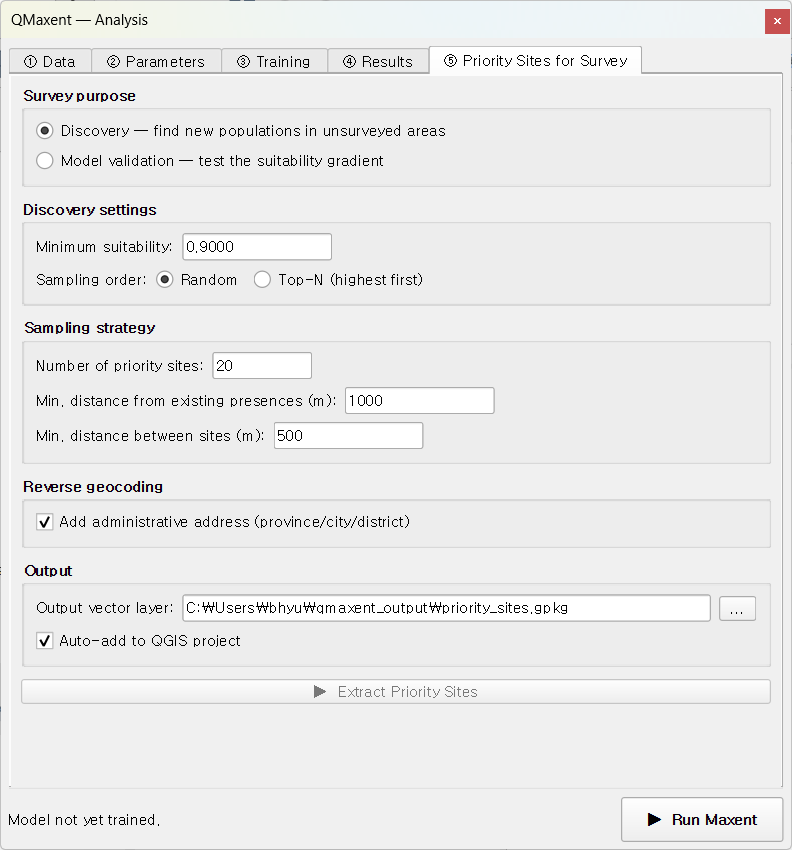
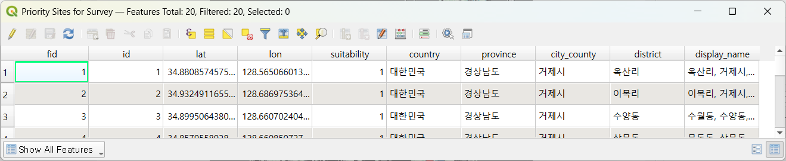
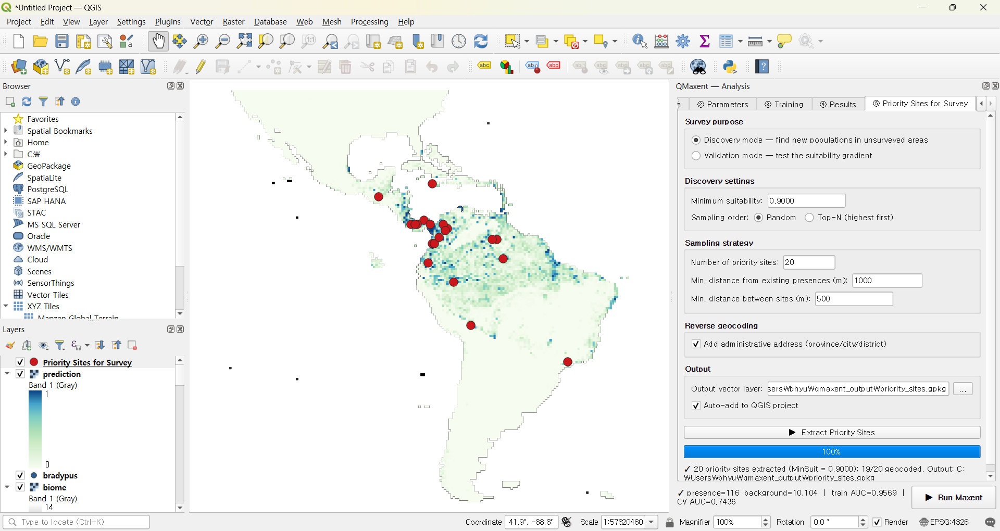

# ⑤ Survey Site Selection

The fifth tab, **⑤ Survey Site Selection** (called *Priority Sites for
Survey* before v0.2.0), turns a habitat-suitability raster into a
**field-ready list of candidate survey sites**. Field surveys usually
have one of two purposes: looking for new populations, or checking the
model in the field. QMaxent supports both with separate sampling
designs grounded in the survey-design literature.

## Survey purpose

Pick one:

| Mode | Goal | Reference |
|---|---|---|
| **High-suitability search** | Look for new populations in unsurveyed high-suitability areas | [Williams et al. 2009](references.md) |
| **Gradient-stratified sampling** | Check the model along its suitability gradient: does observed occurrence follow the predicted suitability? | [Rhoden, Peterman & Taylor 2017](references.md) |

The two modes ask very different questions of the same map, so they
sample it differently:

- **High-suitability search** (formerly *Discovery mode*) samples
  sites only from a band of high suitability, away from known
  occurrences. These are the most promising places to find the species
  where it has not been recorded yet.
- **Gradient-stratified sampling** (formerly *Validation mode*) splits
  the cells above a threshold into four suitability quartiles and draws
  the same number of sites from each. Lower-suitability sites are
  included on purpose, so the field results can show whether the
  species is found more often where the model predicts higher
  suitability.

## Mode settings

Only the settings group of the selected mode is shown.

### High-suitability search settings

| Control | What it does |
|---|---|
| **Minimum suitability** | Cells with suitability at or above this value form the candidate pool. It is filled in automatically as 0.9 × the maximum of the prediction raster when the raster is selected; you can type another value. |
| **Sampling order: Random** (default) | Draws sites at random from the candidate pool. This gives an unbiased sample within the high-suitability band. |
| **Sampling order: Top-N (highest first)** | Takes the cells with the highest suitability first. Use it when you want to maximise the expected hit rate. |

### Gradient-stratified sampling settings

| Control | What it does |
|---|---|
| **Threshold method** | Sets the lower bound of the sampling frame: **10th percentile training presence (T10; Pearson 2007)** (default), **Minimum training presence (MTP; Pearson 2007)**, **Maximum sum of sensitivity + specificity (MaxSSS; Liu 2013)**, or **Custom value...** |
| **Computed threshold value** | The threshold computed from the training data for the chosen method (editable only for **Custom value...**) |

The threshold **only defines the sampling frame**. The cells above it
are split into four quartiles of suitability, and the same number of
sites is drawn from each quartile
([Rhoden, Peterman & Taylor 2017](references.md)). No binary
suitable/unsuitable map is produced, and the threshold is not a claim
that cells below it are unsuitable. Each site carries its quartile in
the `quartile` field (0 = lowest band above the threshold, 3 = highest),
and the layer is styled by quartile. In High-suitability search the field
is always 0.

## Spacing constraints

The **Sampling strategy** group is shared by both modes. Besides the
**Number of survey sites** (default 20), two distance fields define the
spatial structure of the sampled set:

- **Min. distance from existing presences (m)** (default 1,000) keeps
  candidates away from known occurrences. Set it to the species'
  detection radius (e.g. 1 km for a calling fairy pitta, 200 m for a
  slug). This prevents the algorithm from re-sampling territory
  already covered by earlier surveys.
- **Min. distance between sites (m)** (default 500) keeps the
  candidate set spatially independent. A typical value is half the
  distance from existing presences. **Spatially balanced** sampling, in
  the sense of [Stevens & Olsen 2004](references.md), is approximated by
  setting this value to the nearest-neighbour distance you want in the
  final set.

QMaxent enforces both constraints exactly: candidates are dropped, not
moved, when a constraint is violated, so the surviving set is always
within the specification. If the candidate pool cannot supply the
requested number of sites under these constraints, QMaxent returns the
sites it found and reports the actual count.

## Reverse geocoding

When **Add administrative address (OpenStreetMap)** is ticked, QMaxent
calls the [Nominatim](https://nominatim.org) service of OpenStreetMap
for each site. No API key is needed. Reverse geocoding works worldwide.
It adds four generic OpenStreetMap address levels and the full address:

| Field | Address level | Examples |
|---|---|---|
| `country` | Country | Dominican Republic, South Korea |
| `province` | First-level administrative division | a Dominican *provincia*, a Korean province, a US state |
| `city_county` | Municipality | a Dominican *municipio*, a Korean city or county |
| `district` | Locality | a suburb, village, neighbourhood or hamlet |
| `display_name` | Full address text returned by Nominatim | |

A level that OpenStreetMap does not hold for a location is left blank.

**Address language** sets the language of the names:

- **Local names** (default): each country's own names, for example
  Spanish names in the Dominican Republic and Korean names in Korea.
- **QGIS interface language**: the language of your QGIS interface,
  with English as a fallback.
- **English**: English names where OpenStreetMap has them.

The resulting GeoPackage is directly usable for permit applications and
field-team coordination, which matters in jurisdictions where survey
access requires prior notice to the local administration.

Requests are limited to one per second to comply with Nominatim's
fair-use policy, so 20 sites take about 20 seconds. For 30 or more
sites QMaxent first shows the expected time; for large sets, untick
the option or select the sites in smaller batches. Results carry the
attribution © OpenStreetMap contributors.

## Outputs

After clicking **▶ Select Survey Sites**, QMaxent writes:

- **`survey_sites.gpkg`** (default name, in the QMaxent output folder):
  a GeoPackage point layer with the fields `id`, `lat`, `lon`,
  `suitability`, `quartile` and the address fields above. With **Auto-add
  to QGIS project** ticked, it is added to the map as the layer
  **Survey sites**.

If the output GeoPackage already exists, it is replaced, and any layer
of the current project that reads it is removed first. If another
program holds the file open, QMaxent writes to the next free name
instead, such as `survey_sites_1.gpkg`, and reports the name it used.

The training thresholds (MTP, T10, MaxSSS) that Gradient-stratified
sampling can use are also recorded in the model card
(`<model>_model_card.json`, see [Saving and reusing models](saving-models.md)).

The sites are immediately ready for export to mobile-GIS apps such
as **QField**, **Mergin Maps**, or **Locus Map** for offline field use.

## Choosing parameter values

Some practical starting points:

- **Number of survey sites**: 20–30 per species per season is a typical
  field-survey budget for a single team
  ([Robinson et al. 2018](references.md)).
- **Min. distance from existing presences**: the species' typical
  home-range diameter is a good starting point. Too small and you
  re-sample known sites; too large and you push candidates into
  marginal habitat.
- **Minimum suitability** (High-suitability search): the automatic
  value (0.9 × raster maximum) gives a focused search; lower it to widen
  the candidate pool when too few sites satisfy the spacing rules.
- **Threshold method** (Gradient-stratified sampling): T10 or MTP give a
  wide frame that includes lower-suitability cells; MaxSSS gives a
  narrower one.

## Worked applications

- The [Bradypus example](examples/bradypus.md) walks through both modes
  at continental scale.
- The [Pitta nympha example](examples/pitta-nympha.md) shows a
  High-suitability search at municipality scale, with reverse-geocoded
  administrative addresses ready for field permits.

## Next

Move to [Saving and reusing models](saving-models.md) to learn how to
share the trained model with collaborators or re-project it onto a new
raster stack later.
