# Quick start

This walkthrough takes you from a freshly installed plugin to a finished
habitat-suitability map and a list of field survey sites for
*Bradypus variegatus*, the brown-throated three-toed sloth. It is the same
species the original Maxent paper used
([Phillips, Anderson & Schapire 2006](references.md)).

Every step shows the real QGIS screen. The red boxes and numbered
circles on each picture match the numbered instructions below it, so you
can follow along click by click.

!!! tip "Before you start"
    Complete [Installation](installation.md) and
    [Dependencies](dependencies.md) first. The **QMaxent environment
    ready** status must be shown in green before you continue.

!!! info "How long does it take?"
    About 10 minutes in total. Most of that is the model fit in Step 9,
    which runs in the background while QGIS stays usable.

## Part 1. Get the example data

### Step 1. Open the example dataset downloader

{ .qm-shot width="610" }

1. Open the **Plugins** menu in the QGIS menu bar.
2. Point to **QMaxent**.
3. Click **Download Example Dataset...**

### Step 2. Choose Bradypus and download

{ .qm-shot width="540" }

1. Select **Bradypus variegatus**.
2. Check the folder in **Save to**. The default is a `qmaxent_examples`
   folder in your home folder. Click **...** to choose another place.
3. Click **Download**.

The download takes a few seconds. When the message below appears, click
**OK**.

{ .qm-shot width="431" }

### Step 3. Check the layers on the map

{ .qm-shot width="1440" }

1. The **Layers** panel now lists the `bradypus` presence layer and the
   nine environmental rasters (`bio1` to `bio17` and `biome`). The blue
   points on the map are the 116 places where the sloth was recorded.

## Part 2. Prepare the data (① Data tab)

### Step 4. Open the Analysis dock

Choose **Plugins → QMaxent → QMaxent Analysis**. The Analysis dock opens
on the right side of QGIS.

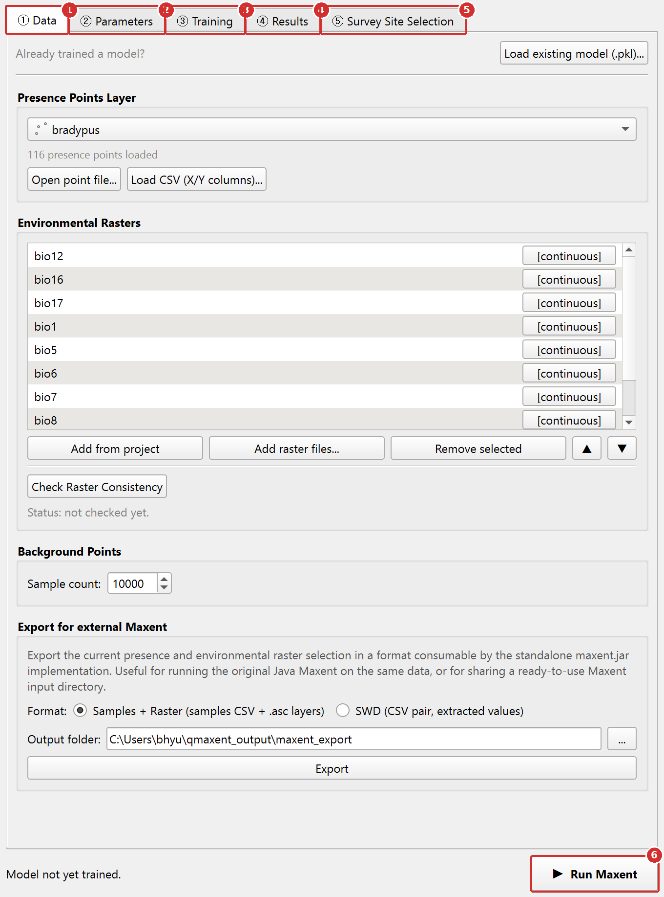{ .qm-shot width="680" }

1. **① Data**: choose the presence points and the environmental rasters.
2. **② Parameters**: set how the model is fitted and evaluated.
3. **③ Training**: follow the model fit and read the log.
4. **④ Results**: look at response curves and variable importance, and
   make the suitability map.
5. **⑤ Survey Site Selection**: pick field survey sites from the map.
6. **▶ Run Maxent** starts the model fit. You use it once the first two
   tabs are ready.

Work through the tabs from left to right.

### Step 5. Choose the presence points

{ .qm-shot width="680" }

1. In **Presence Points Layer**, choose `bradypus`. The line below it
   reads `116 presence points loaded`.
2. **Open point file...** loads a point file (GeoPackage, shapefile and
   others) that is not yet in your project.
3. **Load CSV (X/Y columns)...** loads a table with coordinate columns.
   You do not need either button for this example.

### Step 6. Add the environmental rasters

{ .qm-shot width="680" }

1. Click **Add from project**.
2. Every raster in the project appears in the list. The button on the
   right of each row shows whether QMaxent treats the raster as
   `[continuous]` or `[categorical]`. Click it to change the type.
   Scroll down the list and check that `biome` is marked
   `[categorical]`, because its values are class codes, not amounts.

### Step 7. Check that the rasters line up

{ .qm-shot width="680" }

1. Click **Check Raster Consistency**.
2. The status line turns green:
   `✓ All 9 rasters share grid (CRS: EPSG:4326, resolution: 0.5 × 0.5)`.
   If it turns red instead, see
   [Fixing rasters that do not line up](data-tab.md#fixing-rasters-that-do-not-line-up).

## Part 3. Fit the model (② Parameters and ③ Training)

### Step 8. Review the parameters

Click the **② Parameters** tab. For this first run, keep the defaults.

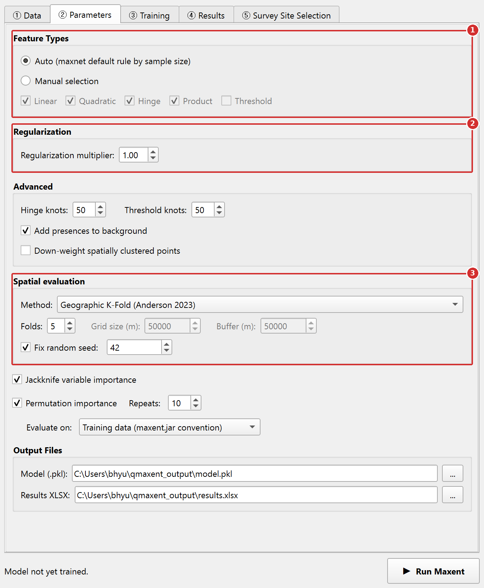{ .qm-shot width="680" }

1. **Feature Types**: **Auto (maxnet default rule by sample size)**
   chooses the feature classes from the number of presences. With 116
   records it uses linear, quadratic, product and hinge (LQPH).
2. **Regularization**: a multiplier of 1.00 is the usual starting value.
3. **Spatial evaluation**: **Geographic K-Fold** with 5 folds checks the
   model on areas it did not see during fitting. **Fix random seed: 42**
   makes the run repeatable.

These defaults are a sensible starting point
([Phillips & Dudík 2008](references.md);
[Phillips et al. 2017](references.md)), not a guarantee of the best
model for your own data.

### Step 9. Run Maxent

Click **▶ Run Maxent** at the bottom of the dock. QMaxent switches to the
**③ Training** tab.

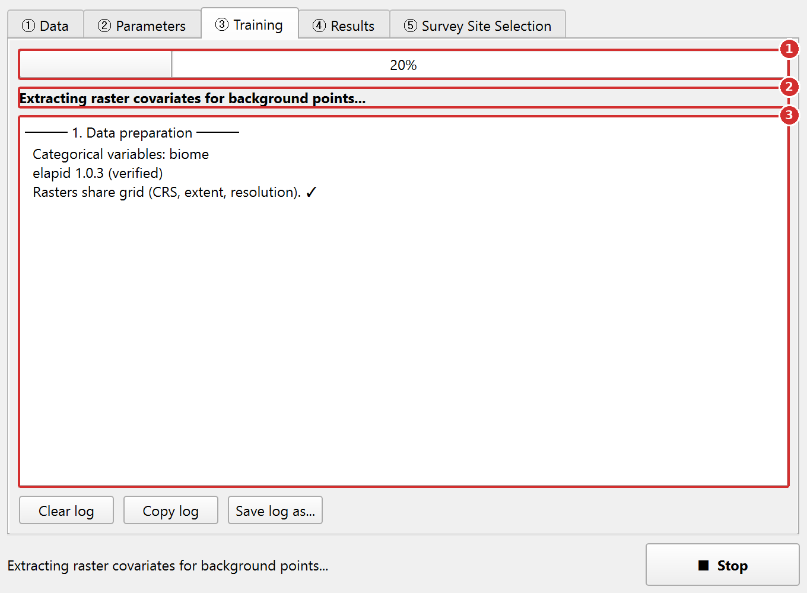{ .qm-shot width="680" }

1. The progress bar shows how far the run is.
2. The line under it names the current step.
3. The log records every step as it happens.

When the run ends, the tab looks like this:

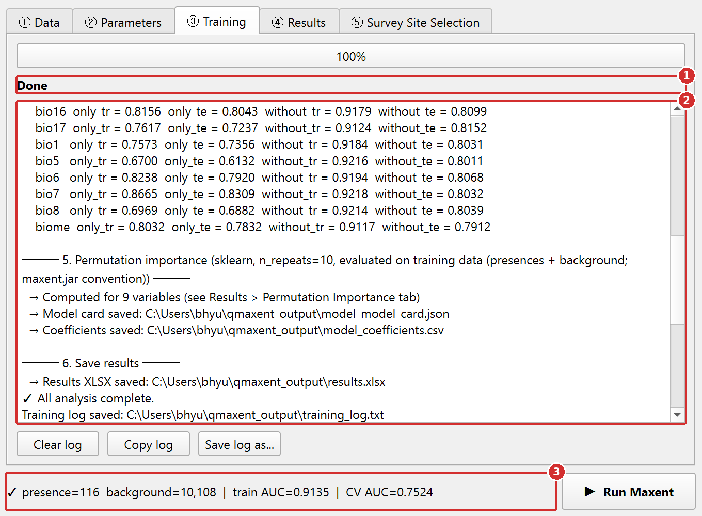{ .qm-shot width="680" }

1. The status line reports the result.
2. The log ends with a summary of the model and the evaluation.
3. The bar at the bottom of the dock keeps the key numbers in view, for
   example `presence=116  background=10,108 | train AUC=0.9135 | CV AUC=0.7524`.

The test AUC from spatial cross-validation is lower than the training
AUC. That gap is normal and honest: it shows how well the model does in
places it was not fitted to ([Roberts et al. 2017](references.md)).

## Part 4. Read the results and make the map (④ Results)

### Step 10. Look at the response curves

Click the **④ Results** tab.

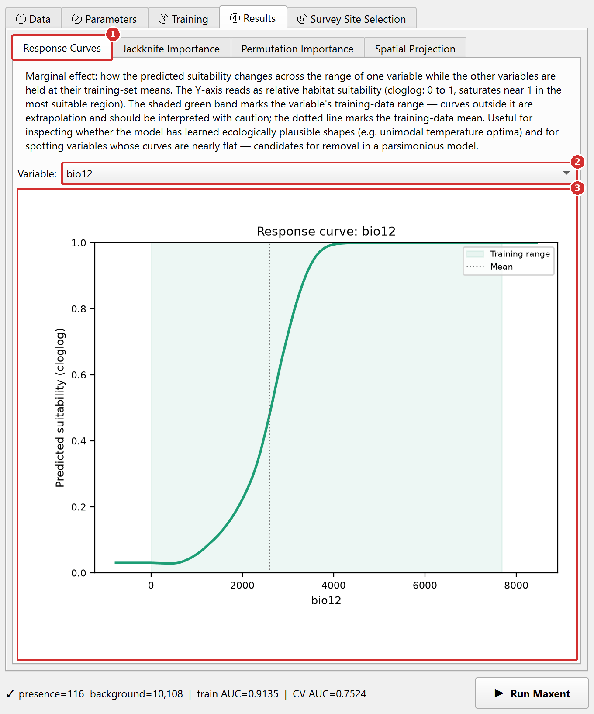{ .qm-shot width="680" }

1. The **Response Curves** sub-tab is open.
2. Choose a variable in **Variable**.
3. The curve shows how predicted suitability changes along that
   variable. The shaded band is the range of values at the training
   points.

### Step 11. See which variables matter

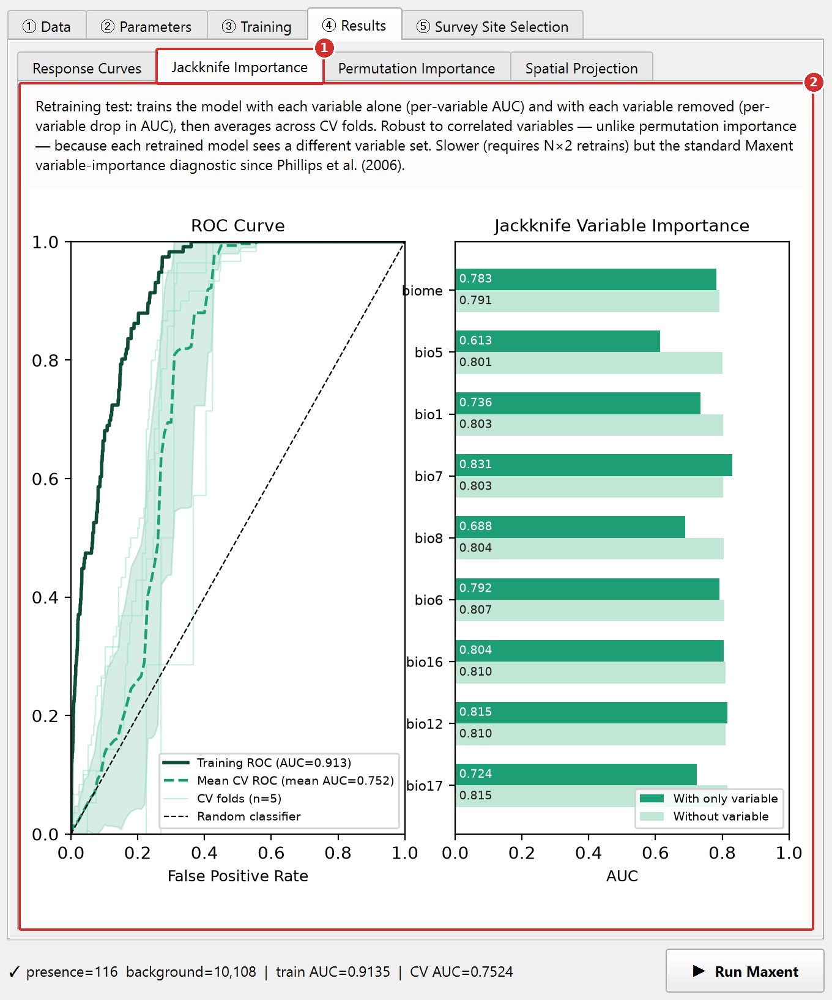{ .qm-shot width="680" }

1. Click **Jackknife Importance**.
2. The left panel shows the ROC curves. The right panel compares the
   model fitted with only one variable and without that variable.

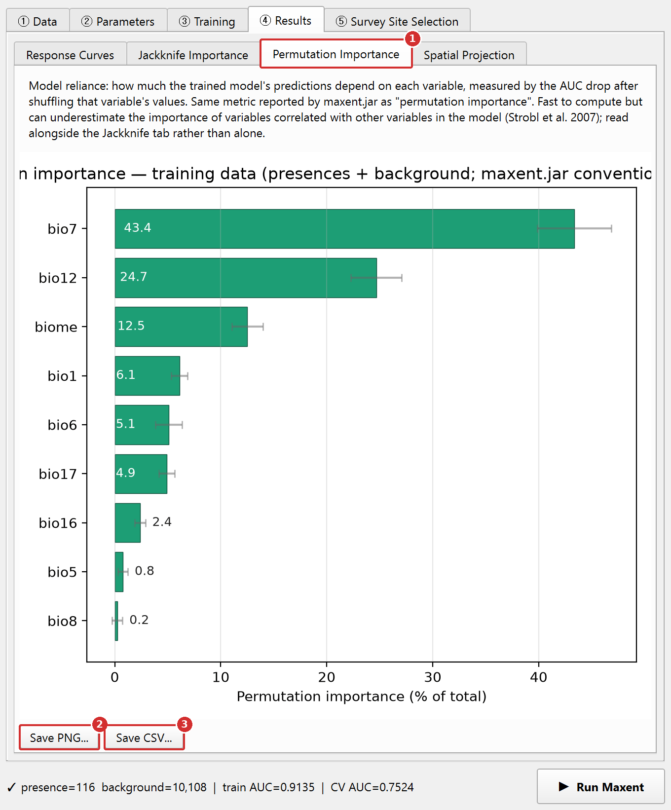{ .qm-shot width="680" }

1. **Permutation Importance** ranks the variables by how much the model
   gets worse when each one is shuffled.
2. **Save PNG...** saves the chart.
3. **Save CSV...** saves the numbers.

### Step 12. Make the suitability map

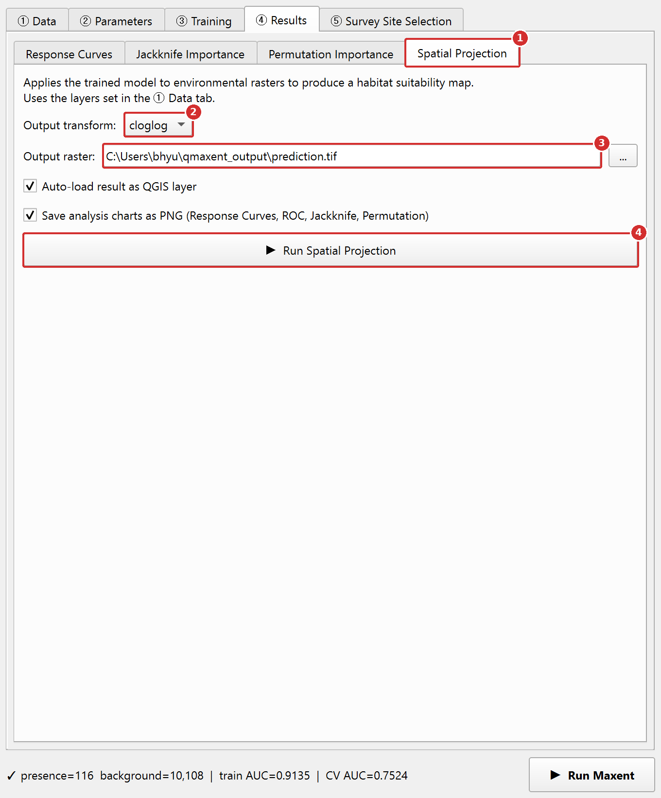{ .qm-shot width="680" }

1. Click **Spatial Projection**.
2. Keep **cloglog** in **Output transform**. It gives values from 0 to 1
   that read as relative suitability ([Phillips et al. 2017](references.md)).
3. **Output raster** is where the map is saved. Click **...** to change it.
4. Click **▶ Run Spatial Projection**.

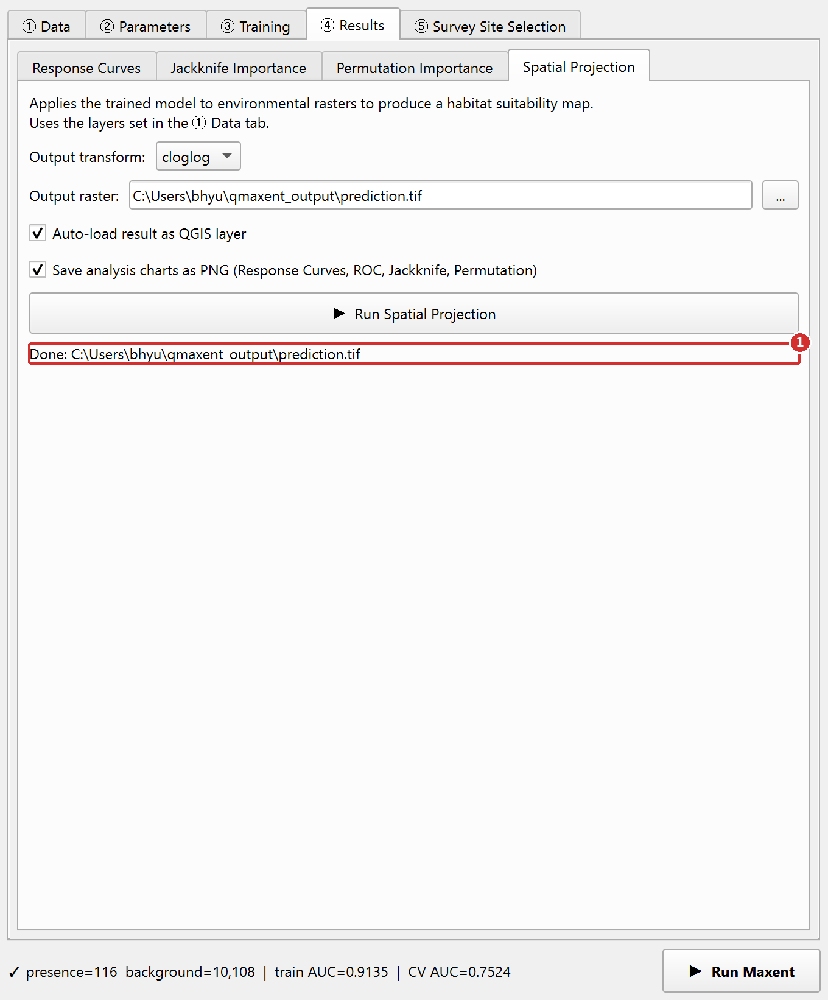{ .qm-shot width="680" }

1. When the status line reads `Done:` followed by the file path, the map
   is saved and added to the project.

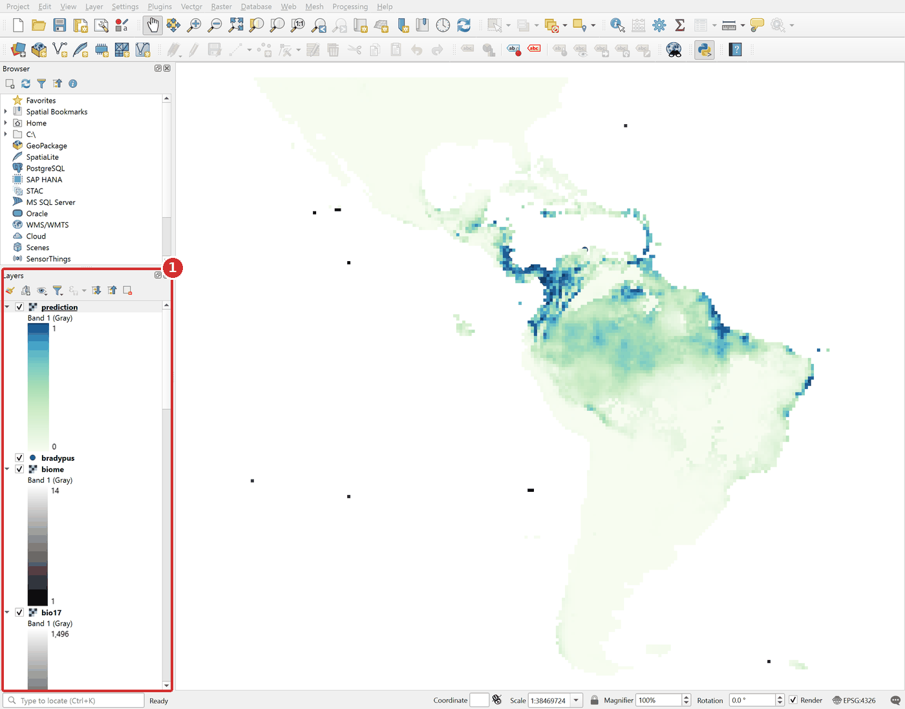{ .qm-shot width="1440" }

1. The `prediction` layer appears in the **Layers** panel. Darker colours
   mean higher predicted suitability.

## Part 5. Pick survey sites (⑤ Survey Site Selection)

### Step 13. Set up the survey

Click the **⑤ Survey Site Selection** tab.

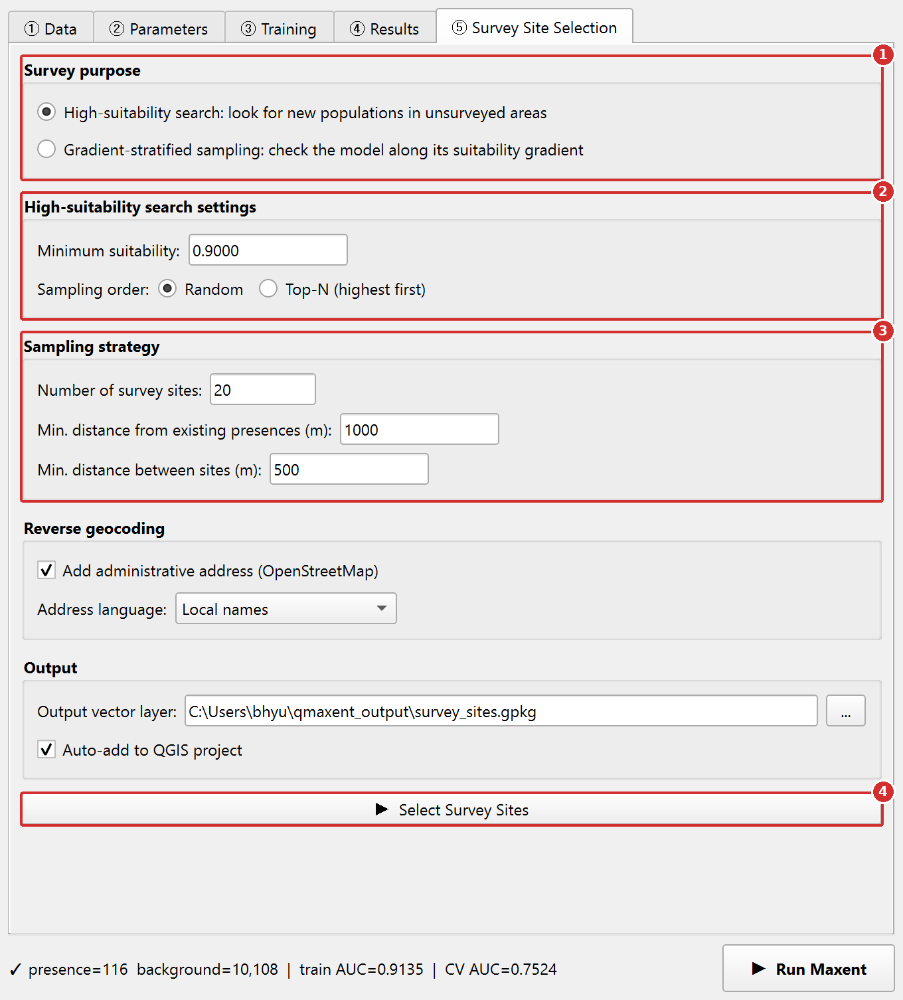{ .qm-shot width="680" }

1. **Survey purpose**: choose **High-suitability search** to look for new
   populations in places that are suitable but not yet surveyed.
2. **High-suitability search settings**: **Minimum suitability** is the
   lowest map value a site may have.
3. **Sampling strategy**: set how many sites you want and how far apart
   they must be from known records and from each other (in metres).
4. Click **▶ Select Survey Sites**.

### Step 14. Check the survey sites

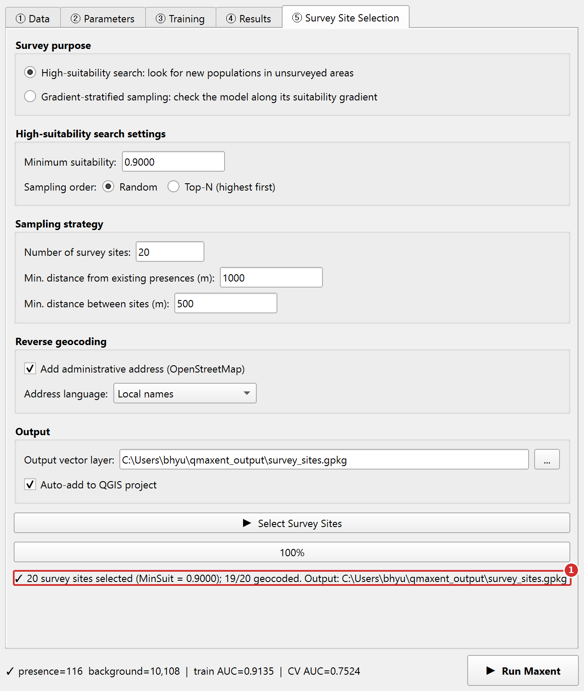{ .qm-shot width="680" }

1. The status line reports the result, for example
   `✓ 20 survey sites selected (MinSuit = 0.9000)`, and where the
   GeoPackage was saved.

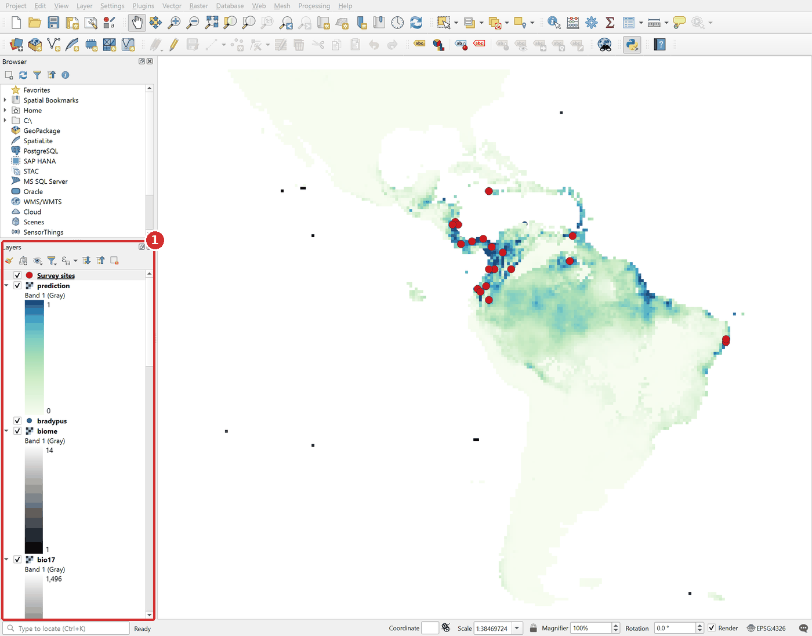{ .qm-shot width="1440" }

1. The `Survey sites` layer is added on top of the map. Open its
   attribute table to see the coordinates, the suitability value and,
   if reverse geocoding was on, the address of each site.

## What you have done

In these steps you ran a complete species distribution modelling
workflow inside QGIS. You loaded presence points and environmental
rasters, checked that the rasters line up, fitted a regularized Maxent
model, evaluated it with spatial cross-validation, read the response
curves and variable importance, mapped habitat suitability and turned the
map into a list of field survey sites.

## Next steps

- Read the **User guide** chapters to learn what each control does and
  when to change its default.
- Work through the [Bradypus worked example](examples/bradypus.md) for a
  closer reading of every plot.
- Practise fixing rasters that do not line up with the
  [Ariolimax example](examples/ariolimax.md).
- Reproduce a published study with the
  [Pitta nympha example](examples/pitta-nympha.md).
