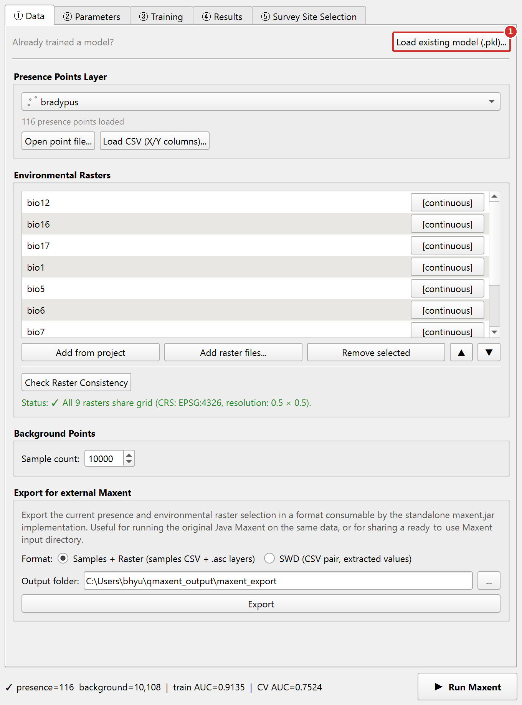
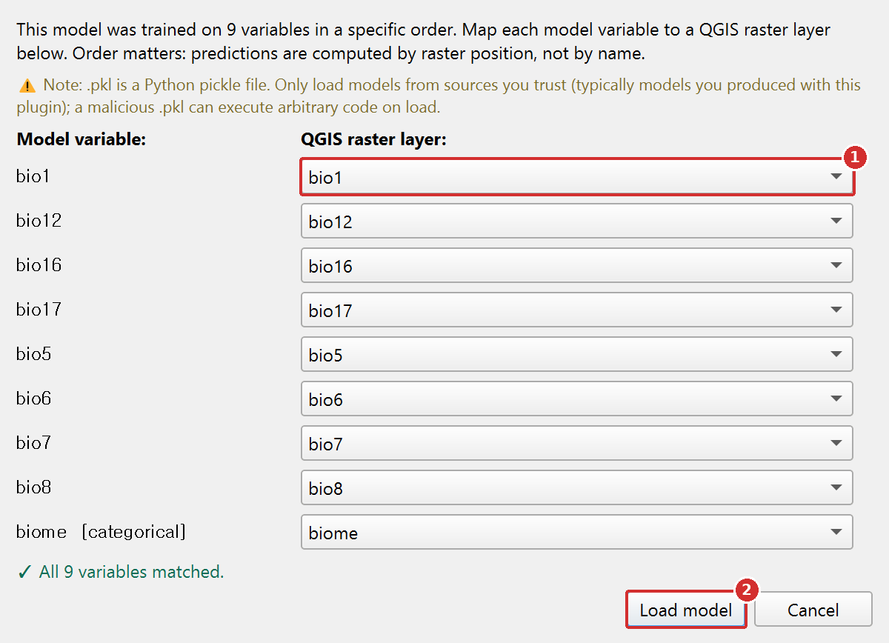

# Saving and reusing models

Persisting a trained model and loading it back later — with confidence
that variables map to rasters correctly — is what enables collaboration,
re-projection onto updated environmental data, and long-term
reproducibility of published QMaxent results.

## Saving a trained model

Every successful Maxent run writes a `model.pkl` file to the path you
specified on the **② Parameters** tab (default
`<project>/qmaxent_output/model.pkl`). This is a Python pickle of the
trained `elapid.MaxentModel` instance — it carries:

- The fitted regularized-likelihood coefficients
- The complete list of variable names (in order)
- For each variable: type (`continuous` / `categorical`), training data
  range (continuous) or class set (categorical)
- The full set of hyperparameters (feature classes, RM, CV scheme,
  random seeds)
- A QMaxent build-version stamp

Treat the `.pkl` as the **canonical record of the trained model**.
Distribute it alongside the `results.xlsx` workbook when sharing with
collaborators or publishing supplementary material — that is the pair
of files [Araújo et al. 2019](references.md) cite as the minimum
reproducibility unit for a published SDM.

## Model card and coefficient table

Since v0.2.0, QMaxent writes two plain-text files next to the `.pkl`,
named after it (for `model.pkl`: `model_model_card.json` and
`model_coefficients.csv`):

| File | Contents |
|---|---|
| `<model>_model_card.json` | Software versions (QMaxent, elapid); settings (feature classes and whether Auto or Manual selection chose them, regularization multiplier, output transform, hinge and threshold knots, CV method and folds, random seed, permutation-importance evaluation data); data summary (presence and background counts, each variable with its type, training range and raster file); performance (training AUC, per-fold and mean CV AUC); thresholds (MTP, T10, MaxSSS); variable importance (permutation and jackknife); model constants |
| `<model>_coefficients.csv` | One row per Maxent feature: index, feature type (linear, quadratic, product, threshold, hinge, categorical), variable, a short description, the knot value for hinge and threshold features, the fitted coefficient, and whether it is non-zero |

Use the model card to report the run in a methods section or a
supplement, and the coefficient table to see which features the
regularization kept. Unlike the `.pkl`, both files are **safe to open and
share**: they contain only text and numbers, no executable code.

## Reloading a saved model

On the **① Data** tab, click **Load existing model (.pkl)…** and select
the saved file. QMaxent reads the variable list out of the pickle and
opens a **variable-mapping dialog**:

### Step 1. Click Load existing model

{ .qm-shot width="680" }

1. On the **① Data** tab, click **Load existing model (.pkl)...** and
   choose the `.pkl` file.

### Step 2. Match each model variable to a raster

{ .qm-shot width="600" }

1. For every variable the model was trained with, choose the raster
   layer that holds it now.
2. Click **Load model**. The raster list is rebuilt in the model's order and
   you can go straight to **④ Results → Spatial Projection**.

The dialog has one row per saved variable. For each row, QMaxent picks
a default raster from the current QGIS project by matching variable
names to layer names. When the names match exactly, the dialog is just
a confirmation step. When they differ, the dialog **forces an explicit
mapping** — the only way to load a `.pkl` whose variable names do not
match the current naming convention is to *consciously* re-state which
raster maps to which saved variable.

This safeguard prevents the silent ordering errors that have been
documented as a recurring source of "but it worked yesterday" bugs in
collaborative SDM projects.

## The variable-mapping dialog in detail

The dialog renders three columns:

- **Saved variable name** — read from the pickle, not editable.
- **Type** — `continuous` or `categorical`, also from the pickle. A
  variable saved as categorical can only be mapped to a raster the
  current project has marked as categorical.
- **Mapped raster** — a drop-down listing the rasters in the current
  project. Pick one for each row.

A footer status line reads `0 of N mapped` and updates live as you
populate the drop-downs. The **OK** button enables only when all rows
are mapped.

After confirmation, QMaxent rewires the dock as if you had just trained
the model fresh — the **③ Training** tab is skipped and **④ Results**
is enabled directly. You can immediately run a spatial projection or
select survey sites against the new raster stack.

## Re-projecting onto an updated raster stack

The most common reason to reload a model is to **apply it to a more
recent or higher-resolution version of the same environmental layers**
without re-fitting. Because re-fitting on different rasters would
produce a different model, this is the only correct way to ask "what
does the original model predict about the new data?".

The workflow:

1. Train the model once on the original rasters; save `model.pkl`.
2. Load the new raster stack into QGIS.
3. **Load existing model (.pkl)…**, map saved variables to the new
   rasters in the dialog, click **OK**.
4. Switch to **④ Results → Spatial Projection** and run.

The preflight dialog will flag any extrapolation introduced by the new
data — particularly important when the new rasters extend the
geographic extent or include time periods outside the original
training range.

## Security note on Python pickle files

`.pkl` files are **Python pickles**, which can contain executable code.
Loading a malicious `.pkl` can run arbitrary code on your machine. Only
open `.pkl` files that you produced yourself or that come from trusted
collaborators. The model card (`.json`) and the coefficient table
(`.csv`) are safe to share and open.

QMaxent has no way to verify the provenance of a third-party `.pkl`
beyond what Python's `pickle` module itself does (which is nothing).
For published QMaxent results, the safe pattern is:

- Distribute the `model.pkl` alongside the `results.xlsx` workbook and
  the model card so reviewers have the deterministic seed,
  hyperparameters, and inputs needed to **re-train an equivalent model
  from scratch** if they prefer not to load the pickle. The model card
  and coefficient table let them inspect the model without opening the
  pickle at all.
- Sign the `.pkl` with a SHA-256 hash in your supplementary materials.

## Next

The companion document is [Exporting results](exporting-results.md),
which describes the multi-sheet XLSX workbook that ships alongside
every `model.pkl`.
